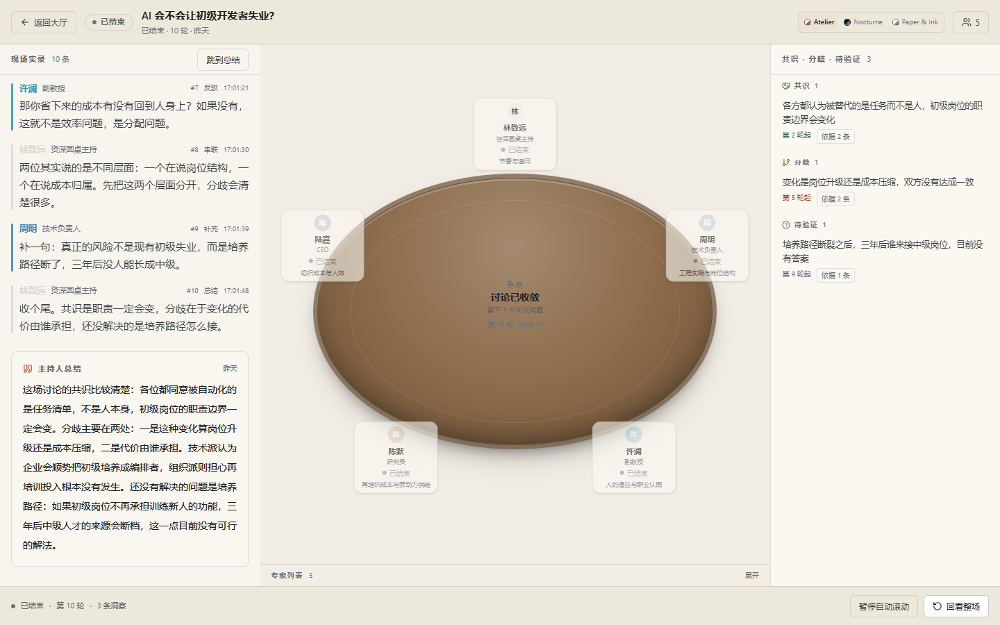
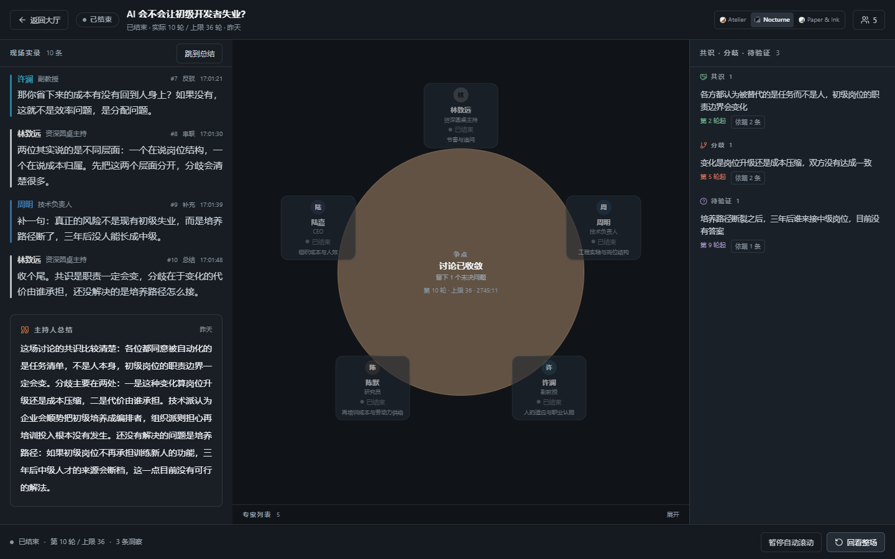
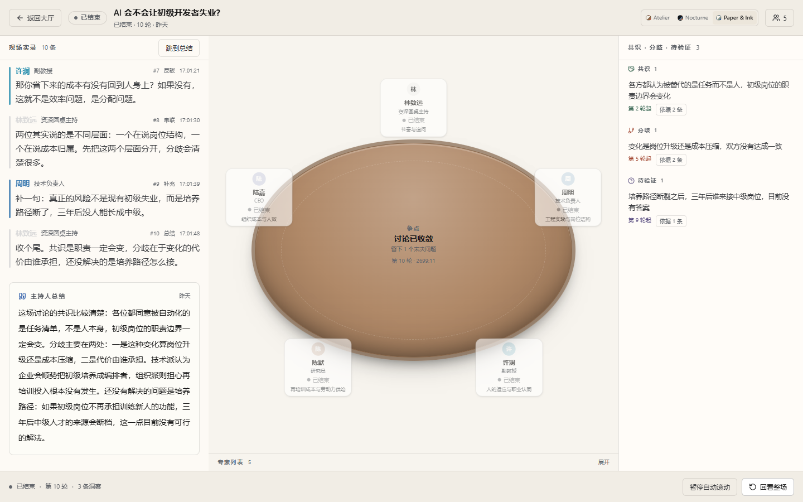
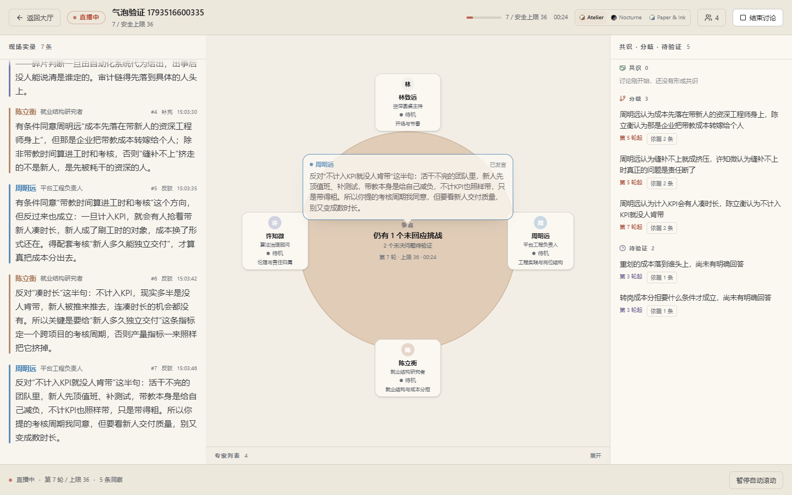

# 深度讨论与圆桌 UI 改版方案 v1.0

- 日期：2026-11-01
- 状态：已裁决，进入实现
- 关联：[PRD](PRD.md)、[AGENT-BEHAVIOR](AGENT-BEHAVIOR.md)、[FRONTEND-PLAN](FRONTEND-PLAN.md)

## 1. 用户反馈转成验收项

| 反馈 | 验收 |
| --- | --- |
| 开始讨论后没有返回大厅按钮 | 演播厅/回放 header 始终有「返回大厅」；直播中返回不结束讨论 |
| 专家状态小窗没显示 Agent 运行状态 | 每个座位显式显示 `待机 / 思考中 / 准备发言 / 发言中 / 已结束`，并显示当前关注点 |
| 思考深度不够 | 真实模式开启 thinking；决策/发言/洞察/总结 prompt 重写 |
| 专家只是在扮演角色，没有观点碰撞 | 每轮必须回应一个具体 messageId；必须表明同意/反对/条件；必须带来新理由/反例/边界；禁止角色自我介绍 |
| 主持人机械控流程 | 主持人先指认当前最强张力/被回避前提，再追问条件/代价；不按顺序点名 |
| 12 轮硬限制 | 结束由观点饱和决定；轮次只做覆盖保底（2n+2）与 36 轮安全上限 |
| 色调过暗 | 60% 中性 + 30% 低饱和主题 + 10% 品牌点缀；默认浅暖方案 |
| 不是圆桌 | 演播厅中心改为圆桌/席位布局，专家围桌而坐，发言者有聚光与状态 |

## 2. 三种配色方案

比例统一：60% 基础中性 / 30% 低饱和主题 / 10% 品牌点缀。

### 方案 A：Atelier（推荐，默认）

关键词：暖纸、胡桃木、蓝灰、朱砂。比当前亮，适合“围桌讨论”而不是“黑箱控制台”。

| 角色 | 色值 | 用途 |
| --- | --- | --- |
| 基础 60% | `#F2EEE6` / `#1C1D1F` / `#C9C3B8` | 暖纸背景 / 墨色文字 / 石灰色分隔 |
| 主题 30% | `#6E7F8D` / `#8B6B4A` / `#D8D2C4` | 蓝灰面板 / 胡桃木圆桌 / 米白卡片 |
| 点缀 10% | `#C8553D` / `#3F6E8C` | 朱砂 LIVE/结束 / 蓝灰链接 |

- 圆桌：淡棕色半透明正圆桌面 + 米白席位卡 + 蓝灰侧栏；纯二维平面，无阴影/木纹/高光。
- 发言者：朱砂细环 + 暖光，不大面积铺红。
- 语义色：共识 `#4F7D6A`、分歧 `#B5533C`、待验证 `#7A6E9E`，降低饱和度。



### 方案 B：Nocturne（夜间演播厅）

关键词：深蓝灰、烟灰、琥珀。保留深色，但比当前黑更有层次。

| 角色 | 色值 | 用途 |
| --- | --- | --- |
| 基础 60% | `#101418` / `#1A2027` / `#2B333D` | 背景 / 面板 / 分隔 |
| 主题 30% | `#5C7189` / `#8E9AA6` / `#C9C3B8` | 蓝灰 / 烟灰 / 暖灰 |
| 点缀 10% | `#D97745` / `#B84A3A` | 琥珀 LIVE / 砖红分歧 |



### 方案 C：Paper & Ink（编辑部）

关键词：纸白、墨黑、鼠尾草、陶土、钴蓝。

| 角色 | 色值 | 用途 |
| --- | --- | --- |
| 基础 60% | `#F7F4EE` / `#171717` / `#D9D4CB` | 纸白 / 墨黑 / 浅灰 |
| 主题 30% | `#8A9A8B` / `#B08968` / `#EFE9DD` | 鼠尾草 / 陶土 / 象牙 |
| 点缀 10% | `#2456A6` / `#D96C4F` | 钴蓝 / 珊瑚 |



**默认采用 A（Atelier）**；B/C 以 `data-theme` token 保留，方便对比和后续切换。实现时所有颜色走 CSS 变量，禁止散落硬编码。

## 3. 圆桌布局

### 1440 桌面

```text
┌──────────────────────────────────────────────────────────────────────┐
│ 返回大厅 | 议题 | LIVE / 轮次 x / 上限 36 | 结束讨论                  │
├───────────────┬──────────────────────────────────┬───────────────────┤
│ 现场实录       │           圆桌舞台                │ 共识/分歧/待验证   │
│ 独立滚动       │   host 在上，专家围正圆桌而坐      │ 独立滚动           │
│               │  发言者聚光 + 席位状态             │                   │
│               │  桌心：轮次/计时/当前张力           │                   │
├───────────────┴──────────────────────────────────┴───────────────────┤
│ 直播状态 / 轮次 / 跳到最新 / 回放控件                                 │
└──────────────────────────────────────────────────────────────────────┘
```

- 圆桌用 CSS 正圆（`aspect-ratio:1` + `border-radius:50%`），淡棕色半透明、无阴影、无木纹；席位绝对定位在圆周外侧。
- 主持人固定上方中点；专家按人数均分在左右/下方。
- 发言者：席位环 + 桌面光斑 + 声波/脉冲；非发言者保持低对比。
- 席位卡显示：头像缩写、姓名、Title、状态 pill、当前关注点（1 行）。
- 发言气泡：发言时在桌面中心显示与席位卡同材质的对话框，内含发言人、状态和正在说的话；发言结束后保留 2 秒并渐隐，下一轮直接替换。文字来自 SSE buffer，不在圆桌上重复渲染完整 transcript。
- 空桌/未开始时，显示“等待主持人开场”。


- 圆桌不随 transcript 滚动；transcript 自己滚动。

### 1024 / 390

- 1024：圆桌 + 右侧 insights 抽屉；transcript 可切到左侧窄栏或 Tab。
- 390：底部 Tab「圆桌 / 实录 / 共识」，圆桌优先；席位卡缩小为头像 + 状态点。

## 4. Agent 状态

每个席位显式显示状态文案，不只靠颜色：

- `待机`：灰点
- `思考中`：琥珀脉冲（模型调用中、尚未首 token）
- `准备发言`：已选中、尚未开始流式
- `发言中`：朱砂环 + 音柱
- `已结束`：低对比

状态必须同时出现在圆桌席位与（可折叠的）专家列表；不能只显示颜色。

## 5. 结束条件：观点饱和，不是轮数

**轮数只做两道护栏，不作为目标，也不作为结束条件。**

- `coverageFloor = min(12, 2 * expertCount + 2)`：覆盖保底，保证每位专家至少 2 次、主持人有开场 + 至少 1 次追问。
  - 3 位 → 8；4 位 → 10；5/6 位 → 12。
  - 低于这个轮次不允许收束，避免“没聊透就总结”。
- `maxTurns = 36`：安全上限。到 36 必须收束，并在总结里显式列出未解决争点/未回应挑战。
- **主收束信号 = 观点饱和**（由 `debateMap.saturation` 计算）：
  1. 每位专家至少发言 2 次；
  2. 所有 `openChallenges` 已被回应，或被明确承认为“未解决”；
  3. 最近 4 轮没有产生新洞察、新争点、新反例；
  4. 主要 `divergence` 至少被双方各回应一次；
  5. 主持人至少做过 1 次张力指认/条件追问。
- 满足饱和 → 主持人做 `summary`，结束；不满足 → 继续，**不看 plannedTurns**。
- `plannedTurns` 字段保留做 API 兼容，但语义改为 `coverageFloor`；UI 不再显示“目标 28 轮”。
- 不允许“为了凑轮数”重复；重复检测会触发换人/换角度。
- UI 显示：`轮次 14 / 安全上限 36` + `争点收敛度`/`未解决挑战 N`，轮次不是进度目标。

## 6. 辩论协议（Prompt/上下文核心改动）

### 6.1 每轮必须发生的事

1. 回应一个具体 `messageId`（不是泛泛“刚才有人说”）。
2. 明确关系：反对 / 支持 / 有条件同意 / 澄清误读。
3. 新增至少一个：新理由、新反例、新边界、新代价。
4. 不复述自己的角色定义，不以“作为……”开头，不重复上一轮核心句。
5. 1–2 句，专家 ≤120 字，主持 ≤60 字。

### 6.2 上下文新增 `debateMap`

确定性投影，不额外调用 LLM：

```text
# 当前争论结构
## 未回应的挑战
- [m_12] 许澜(反驳)→陈默：……
## 各方当前主张
- 陈默：……（第 3 轮）
- 许澜：……（第 4 轮）
## 尚未解决的张力
- 效率优先 vs 分配优先
## 被回避的前提
- “企业愿意为再培训买单”尚未被任何一方证明
## 饱和判定
- ready=false
- reasons: [open_challenge=1, new_claim_in_last_4=true, divergence_unanswered=1]
```

- 从 messages 的 `targetMessageId`、intent、speaker 派生。
- 未回应挑战 = 被 rebut/probe 指向、尚未被 target 回应的 message。
- 每位专家只取最近一条主张，避免“角色小传”。
- 放在 speech/decision 的上下文前部，优先于 persona。
- `saturation` 必须给出 `ready` 和 `reasons`，主持人/调度器按它判断是否收束；不能只给一个布尔值。

### 6.3 主持人

- 开场：切开一个可争论的命题，点 2–3 人，不点名头衔。
- 中段：先指认“你们其实在争 X”，再追问一个条件/代价/反例；不按顺序点名。
- 收尾：只讲争出了什么、还差什么；不逐人总结，不替专家下结论。
- 禁止“下面请 X 发言”式机械串场。

### 6.4 Prompt 结构

- System：辩论规则 + 反角色扮演 + 输出长度。
- User：议题 + 当前争论结构 + 最近 transcript + 你的上一轮主张 + 本轮 target + 必须新增的东西。
- 禁止把“你的立场”写成必须维护的教条；允许专家在被说服时明确让步/修正。
- 允许 `clarify` 承认“我被误读/我改变条件”，这比硬撑角色更真实。

## 7. Thinking 模式

- 真实模式：`DEEPSEEK_THINKING=enabled`。
- **按 prompt 分配**：
  - `P-SPEECH` / `P-SUMMARY`：开启 thinking（观点深度、收尾质量）。
  - `P-DECIDE` / `P-INSIGHT` / `P-ROSTER`：关闭 thinking。原因：JSON-only 调用 + 小 `max_tokens` 时，推理会吃掉全部输出预算，`content` 变空，导致决策/洞察失败。
  - 全局 `DEEPSEEK_THINKING=disabled` 仍可一键全关。
- 输出预算：speech 1200、summary 1400（含推理 token）；decision 240、insight 900、roster 1200。
- 超时：decision 45s、speech 90s、insight 45s、summary 90s；首 token 20s。
- UI：模型调用期间显示 `思考中`；首 token 后切 `发言中`。
- 不在 UI 展示 `reasoning_content`；只显示公开关注点/意图。
- 成本/延迟：36 轮只是安全上限，不是每场必跑满；观点饱和即收，未饱和才继续。
- 若真实 API 因 thinking 参数拒绝：按后端诊断的 `upstreamStatus` 回退到不发该字段，并记录。

## 8. 角色分工

| 角色 | 任务 |
| --- | --- |
| AI/Agent | debateMap、speech/decision/host prompt 重写、thinking 策略、eval 指标（引用率/反驳率/重复率/新论点率）、round policy |
| 后端 | `plannedTurns/maxTurns`、thinking/timeout 配置、状态事件、`action=close` 支持（如需要）、测试 |
| 前端 | 返回大厅、圆桌舞台、席位状态、Atelier 主题 + B/C token、响应式、测试 |
| 测试 | 更新轮次/布局/状态/返回大厅用例；真实 thinking smoke；回归 |

## 9. 验收

- [ ] 演播厅任何状态都有「返回大厅」，直播中返回不结束讨论。
- [ ] 每个专家席位显示显式状态文案 + 当前关注点。
- [ ] 真实模式 `llmMode=real`、thinking 开启，单场按**观点饱和**收束；未饱和可超过 coverageFloor，最长 36。
- [ ] coverageFloor 之前不结束；饱和时可提前结束；36 轮强制 summary 并列出未解决争点。
- [ ] 每轮发言至少引用一个具体 messageId；无纯角色独白。
- [ ] 主持人至少一次指认张力/追问条件，不只是点名。
- [ ] 1440 圆桌舞台可见，三栏不重叠；1024/390 无整页滚动。
- [ ] 颜色比例符合 60/30/10；正文对比度达标。
- [ ] E2E/typecheck/test/build 全绿。
