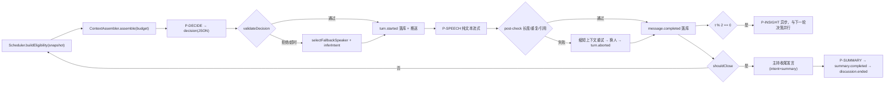

# AI Agent 行为规范 v0.1

- 日期：2026-10-31
- Owner：AI/Agent 工程师
- 状态：G1 设计稿，待 PM 裁决 8 项（见 §13）后冻结为 v1.0
- 关联：[PRD](PRD.md) §7 AR-01~AR-11、[API 契约](03-API契约.md)、[SSE 事件契约](04-SSE事件契约.md)、[ER](ER.md)、[角色 SOP](02-角色与协作SOP.md)、[Prompt 清单](prompts/00-INVENTORY.md)
- 范围：**只定义 Agent 怎么想、看什么、说什么、失败怎么办**；不定义 HTTP/DB/SSE/UI 实现。

---

## 0. 一页结论

十条硬决策，后面各章都是它们的展开：

1. **一场讨论 = 1 次阵容 + 每轮 2 次 LLM（决策、发言）+ 节流的共识 + 1 次总结**。不给"每个专家都想一遍"的假自主，成本与延迟不允许。
2. **轮次公式**：`totalTarget = clamp(4 + 2n, 8, 12)`，`hardCap = min(totalTarget + 2, 14)`。主持人固定 4 席（开场/追问/串联/收尾）。
3. **"谁来发言"由 LLM 决策，但合法性由确定性守卫裁决**。模型只能从 `allowedSpeakers` 里挑；挑了别人的，规则兜底覆盖，永不空轮。
4. **不做"举手"**。产品原文的"举手/抢答"是行为效果，不是 UI 事件：被选中即进入 `preparing`，首 token 即 `speaking`。理由：避免为每轮多一次调用、避免暴露"意愿"这种内部状态。
5. **发言是纯文本流式，不走 JSON**；阵容/决策/共识走 JSON mode；总结走纯文本三段。JSON 只存在服务端，永不出现在 UI。
6. **上下文 = 确定性投影，不做递归摘要**。最近 8 条全文 + 更早的"一行人摘要" + 结构化共识快照 + persona + 轮次计划。每轮输入预算 ≤ 3.5k tokens。
7. **共识必须有 ≥2 位不同发言者的证据**，分歧必须有 ≥2 位不同发言者并写出"分歧轴"；证据 id 不在白名单 → 整条丢弃，不改写、不补造。
8. **公开/隐藏由白名单映射强制**：内部结构 `InternalDecision` → 公开结构 `PublicTurn`，只拷白名单字段；`reasoning_content` 在 adapter 层剥离并计数。
9. **任何失败都不允许让会话停在 `live`**：发言失败 → 中断该轮并换人（`turn.aborted` 或 T7 隐式规则）；连续 3 次 LLM 失败 → 强制收尾；总结失败 → 模板总结（标注降级）→ `ended`。
10. **行为下限靠守卫，上限靠 prompt**。prompt 只负责"说得好"；"不机械轮转、不超长、不重复、必收尾"由代码保证——因为 eval 和演示都不能依赖模型状态。

关键常量（后端可直接按此建运行时配置）：

| 常量 | 值 | 依据 |
| --- | --- | --- |
| `TARGET_TURNS(n)` | `clamp(4 + 2n, 8, 12)`（n=3→10，n≥4→12） | PRD §10.4 的 8–12 轮 |
| `HARD_CAP` | `min(TARGET_TURNS + 2, 14)` | PRD §10.4 硬上限 14 |
| `EARLY_STOP_MIN` | ~~8~~（已废） | 见 §3.4：早停会让主持占比到 50%，已删除 |
| `HOST_MAX_TURNS` | 4（开场 1 + 中段 2 + 收尾 1） | AR-02 |
| `CONSECUTIVE_MAX` | 2（策略目标 1） | AR-03 / PRD §10.4 |
| `SPEECH_MAX_CHARS` | 120（目标 ≤ 80） | AR-04 |
| `SPEECH_SENTENCES` | 1–2 | AR-04 |
| `FOCUS_MAX_CHARS` | 20 | 专家状态小窗空间 |
| `TRANSCRIPT_WINDOW` | 最近 8 条全文 + 前 8 条一行人摘要 | §5.3 |
| `INSIGHT_CAP` | 共识 8 / 分歧 6 / 待验证 6 | 全量快照体积 |
| `INSIGHT_EVERY` | 每 2 条专家发言 | §7.5 |
| `DECISION_TIMEOUT` | 8s | NFR-01 轮间隔 p95 < 8s |
| `SPEECH_TIMEOUT` | 首 token 6s / 总计 20s | NFR-01 |
| `ROSTER_TIMEOUT` | 20s（含 1 次重试） | NFR-01 生成 p95 < 12s |
| `SUMMARY_TIMEOUT` | 25s | 收尾不能卡死 |
| `SESSION_WATCHDOG` | 90s 无新持久化事件 → 强制收尾 | §9.3 |
| `LLM_CONCURRENCY_GLOBAL` | 4（后端执行） | 多会话并行不互相打爆 |

---

## 1. Agent 拓扑与一轮的生命周期

### 1.1 组件（都在 `packages/agent`，纯函数 + 一处 adapter）

| 组件 | 职责 | 是否调 LLM |
| --- | --- | --- |
| `RosterBuilder` | 生成主持人 + 专家，校验多样性 | 是（P-ROSTER） |
| `ContextAssembler` | 从会话快照构造 `ContextBundle`，按预算裁剪 | 否 |
| `Scheduler` | 计算准入集、义务、收尾条件 | 否 |
| `DecisionMaker` | 选下一位 + 意图 | 是（P-DECIDE） |
| `SpeechWriter` | 生成一位专家的发言（流式） | 是（P-SPEECH/expert） |
| `HostWriter` | 主持人开场/追问/串联/收尾 | 是（P-SPEECH/host） |
| `InsightExtractor` | 全量快照更新共识/分歧/待验证 | 是（P-INSIGHT） |
| `Summarizer` | 自然语言总结 | 是（P-SUMMARY） |
| `Guards` / `Validators` | 硬约束、后置校验、降级选择 | 否 |
| `LLMAdapter` | 请求、流式、超时、剥离 `reasoning_content` | 是（唯一 IO） |

边界：`Scheduler`/`ContextAssembler`/`Guards` 必须**纯函数可单测**，不读时钟、不读全局、不读 DB。时间与随机数由调用方注入。

### 1.2 一轮的时序



硬规则：

- **`turn.started` 必须收口**：理想是 `message.completed` / `turn.aborted`；若 PM 采纳后端的 T7「隐式中断」规则（不加事件），则退化为"下一轮 `turn.started` 或终态事件即视为上一轮作废"。两种都能跑，见 §11.2-B1 的取舍。前端不会永久高亮。
- **`turn.started` 发射时机 = 决策完成、首个 token 之前**（约 300–800ms 抖动延迟后）。这样前端能先亮 `preparing`，再随首个 delta 切 `speaking`。
- 同一会话串行；`P-INSIGHT` 与下一轮 `P-DECIDE` 可并行，但与 `P-SUMMARY` 互斥（总结前必须结算快照）。

### 1.3 时序预算（NFR-01 对齐）

| 段 | p50 | p95 | 说明 |
| --- | --- | --- | --- |
| 决策 | 1.2s | 2.5s | 输入 ~2.6k tokens，输出 ~60 tokens |
| 抖动延迟 | 0.5s | 0.9s | 纯前端节奏，可 reduced-motion 关闭 |
| 发言首 token | 0.9s | 3.0s | NFR-01 给到 5s，留余量 |
| 发言完成 | 2.5s | 5.0s | ≤120 字 |
| 轮间隔（从上一条 completed 到下一条 started） | 2.2s | 7.0s | 目标 p95 < 8s |

一轮 = 决策 + 发言两次串行调用。这是延迟下限，因此**拒绝"每个专家并行想一遍再投票"**的方案：n=4 时每轮 4 次调用，p95 必然破 8s，成本 ×2。

---

## 2. 人设生成

### 2.1 字段

`Roster` 输出与 `EXPERT` 实体对齐，另加两个**必填**行为字段（见 §11.2-B5）：

| 字段 | 类型 | 约束 | 用途 |
| --- | --- | --- | --- |
| `role` | `host` \| `expert` | 恰好 1 个 host | — |
| `name` | string | 中文 2–4 字，全场唯一，不得用真实公众人物名 | 头像/发言标识 |
| `profession` | string | ≤ 12 字 | transcript 副标题 |
| `title` | string | ≤ 16 字 | transcript 副标题 |
| `stance` | string | ≤ 40 字，一句可反驳的主张（专家）/ 中立声明（主持） | 阵容确认页核心 |
| `stanceAxis` | string | ≤ 16 字，**必填**。这条立场在争什么（如"岗位替代 vs 岗位重构"） | 去重、立场覆盖、分歧轴 |
| `polarity` | enum | `strong_oppose \| oppose \| neutral \| support \| strong_support`，**必填** | 覆盖度校验、fallback 打分 |
| `dimension` | enum | `tech \| economy \| organization \| ethics \| user \| regulation`，建议填 | 维度覆盖 |
| `style` | enum | `data \| case \| principle \| engineering \| humanist`，建议填 | 论证风格差异 |
| `focus` | string | ≤ 20 字，初始关注点 | 状态小窗默认文案 |
| `colorKey` | enum | 8 色调色板之一，全场唯一；host 固定中性色 | 前端映射 hex |

> 颜色：模型只选 `colorKey`，**不输出 hex**。调色板常量在 `packages/shared`，服务端校验唯一性。这样换主题/换对比度不用改 prompt，也不会出现模型编造的低对比色。

### 2.2 差异化四维（AR-01 的可执行定义）

"立场互补"不能只看 `stance` 文案，按四维打分：

| 维度 | 要求 | 校验方式 |
| --- | --- | --- |
| 主张轴 | 至少 2 个不同 `stanceAxis`，且同一 axis 不超过 `ceil(n/2)` 人 | 字符串归一化后比较 |
| 极性 | `polarity` 至少 3 种；**必须有至少 1 人在反对侧**（`oppose`/`strong_oppose`）且至少 1 人在支持侧 | 枚举计数 |
| 关注维度 | `dimension` 至少 3 种；必须至少 1 个"二阶关注"（`ethics`/`regulation`/`organization` 中任一） | 枚举计数 |
| 论证风格 | `style` 至少 3 种；不得全员 `principle` | 枚举计数 |

补充规则：

- 4 个同质化"专家"是最常见的失败模式，所以**禁止全员同一 `stanceAxis`**，即使极性不同（那是"同题正方/反方"，不是"互补视角"）。
- 主持人 `stance` 必须是"中立，负责追问与串联"一类声明，`polarity=neutral`，不得有主张。
- 姓名不得与议题强绑定（如议题"AI 裁员"就叫"裁员专家"），避免像模板。

### 2.3 去重与修复

生成后跑 `validateRoster`，失败**不回炉重生成整份**，而是尽量局部修复（省时省钱）：

| 失败 | 处理 |
| --- | --- |
| 人数不对 | 重试 1 次；仍不对 → 截断/补模板位 |
| 姓名重复 / 像真人名人 | 直接替换为该风格模板名（本地姓名池），标记 `repaired` |
| 颜色重复 | 按调色板顺序分配给未占用色（确定性） |
| `stanceAxis` 全同 | 重试 1 次；仍同 → 把第 n 位改写为"二阶视角"（伦理/成本）模板 |
| 缺反对侧 | 重试 1 次；仍缺 → 翻转最后一位的 `polarity` 与其 `stance`（用模板句"但代价是……"）并标记 |
| JSON 无效 | 修复重试（把 Zod 错误回灌，缩短输出要求）；仍失败 → 模板阵容 |

### 2.4 模板阵容（最后兜底，`degraded=true`）

6 个参数化席位，按优先级取前 n 个：技术实践者 / 经济学或成本视角 / 组织与人力 / 伦理与监管 / 用户与产品 / 怀疑论者（反方）。

- 每人 `stance` 由"议题关键词 + 视角模板"拼成，不含具体数据，不冒充专业结论。
- 只用于"模型完全不可用"的演示保命，UI 标注"已使用备用阵容"，QA 可断言。

---

## 3. 主持人行为

### 3.1 职责与配额（AR-02）

| 类型 | intent | 次数 | 触发时机 | 必须包含 |
| --- | --- | --- | --- | --- |
| 开场 | `opening` | 1（第 1 轮） | confirm 后立即 | 点题 + 给出 1 个具体切口 + 邀请 2–3 位点名（不念全部人设） |
| 追问 | `probe` | ≥1 | 第 2–4 轮内 | 指向某位专家的某句话，要求"具体化/举证/给反例" |
| 串联 | `mediate` | ≥1 | 第 4–8 轮 | 点名 2 位不同专家，指出他们"其实在争什么"，不站队 |
| 转向 | `redirect` | 0–1 | 覆盖出现空洞时 | 指出"还没人谈 X"，点名未发言专家 |
| 收尾 | `summary` | 1（最后 1 条 transcript） | `shouldClose` 为真 | 1–2 句收束，不复述全文（完整总结在 summary 事件） |

`HOST_MAX_TURNS=4`。5 种类型里最多用 4 次，优先级：`opening` > `probe` > `mediate` > `summary` > `redirect`（`redirect` 只在"有专家没发言 且 轮次还够"时占用 `probe` 或 `mediate` 的名额）。

### 3.2 各阶段的写法要求

- **开场**：不得自我介绍超过 1 句；不得复述议题原文；必须给一个"可争论的切口"（如"先不谈会不会失业，先谈初级岗位的哪部分工作正在消失"）。
- **追问**：必须引用被追问者的原话片段（≤15 字），并给出具体的追问角度（举证 / 边界 / 反例 / 代价），三选一。禁止"你怎么看"这种空追问。
- **串联**：必须点名 2 位、复述各自主张各 ≤15 字、指出冲突点或共同前提，最后把球抛给其中一位或第三方。禁止总结成"大家都同意"。
- **收尾**：只讲"这场争出了什么、还差什么"，不复述每个人说了什么。

### 3.3 防霸麦（这是最容易翻车的地方）

1. **硬配额**：主持发言 ≤ 4，且 `hostTurns ≤ expertTurns / 1.5`。n=3 时专家 6 条 → 主持 4 条刚好达标；若专家不足 6 条，主持必须先让位。
2. **单条字数反向约束**：主持单条 ≤ 60 字（比专家 120 字更短）。主持一旦长篇，观感立刻变成"讲课"。
3. **不允许连续主持**：`mediate` 之后必须至少 1 条专家发言，才能再出主持。
4. **不允许主持替专家下结论**：主持句中禁止"所以结论是/显然/大家都知道"，由后置校验拦截（正则 + 重写 1 次）。
5. **禁止主持点名同一个人连续 2 次以上**（那是访谈，不是圆桌）。

### 3.4 收尾触发（`shouldClose`）

两档，任一满足即触发；触发后**下一轮必须是主持收尾**，不再走决策：

| 档 | 条件 |
| --- | --- |
| 必须收（hard） | `turnIndex > maxTurns`（`plannedTurns + 2`，上限 14） |
| 应改收（target） | `turnIndex >= plannedTurns`（n=4 时 = 12） |

**已删除 early_stop（v1.1 修正）**：原设计允许在第 8 轮早停，但主持固定 4 席（开场/追问/串联/收尾），
4/8 = 50% 主持占比 + 每位专家仅 1 次发言，**数学上不可能同时满足「主持 ≤1/3」与「每人 ≥1 次且不独角戏」**。
实现（`evaluateClose`）与 eval 都已按"收束点固定为 plannedTurns"对齐；`CloseReason` 也去掉了 `early_stop`。

不能收的情况：还有专家 0 发言（只在 `hard_cap` 前成立，触发 coverage 强制）。

---

## 4. 发言调度

### 4.1 轮次预算

| 专家数 n | totalTarget | hardCap | 主持上限 | 专家席位数 |
| --- | --- | --- | --- | --- |
| 3 | 10 | 12 | 4 | 6 |
| 4（默认） | 12 | 14 | 4 | 8 |
| 5 | 12 | 14 | 4 | 8 |
| 6 | 12 | 14 | 4 | 8 |

- **"轮"的口径**：一条完整发言 = 一轮（含主持人）。`turnIndex` 从 1 开始，`turn_count` 在 `message.completed` 时 +1。
- n=5/6 时专家席位数 8 < n×2，因此**覆盖优先于均分**：先保证每人 1 次，剩余按"谁的观点还没被回应"分配。
- 这就是为什么 `GET /:id` 需要 `plannedTurns`（见 §11.2-B7）：前端进度条的分母不能靠前端自己算公式。

### 4.2 意图分类（AR-03）

统一 9 值，按角色限制：

| intent | 谁能用 | 含义 | 必须带 `targetMessageId` |
| --- | --- | --- | --- |
| `opening` | host | 开场 | 否 |
| `probe` | host | 追问/点名要举证 | 是（被追问的那条） |
| `mediate` | host | 串联两位、指出冲突轴 | 是（把球抛向的那条） |
| `redirect` | host | 转向未覆盖的维度 | 否 |
| `rebut` | expert | 反对某条具体发言 | 是 |
| `support` | expert | 支持某条并加码 | 是 |
| `extend` | expert | 补新维度/新证据，不针对个人 | 否 |
| `clarify` | expert | 澄清自己被误读 / 修正自己上一条 | 可（指向误读来源） |
| `summary` | host | 收尾 | 否 |

> 契约现状只有 6 个值（`opening/probe/rebut/support/extend/summary`），缺 `clarify/mediate/redirect`。**没有 `mediate`，"串联"就只能伪装成 `probe`，前端标签会错**；没有 `clarify`，"被误读后解释"只能算 `extend`，会造成假分歧越滚越大。

意图选择规则（给模型的软规则，给代码的硬规则）：

- `rebut/support/clarify` 必须有 `targetMessageId ∈ 别人（clarify 可指自己）的已完成发言`，否则降级为 `extend`。
- 若最近 2 条发言已连续 `rebut` 同一人 → 禁止第 3 次 `rebut` 同一目标，强制换目标或换 `extend`（防止"两个人对喷"）。
- `support` 不得空转：必须补一条新理由/新例子，否则改 `extend`。

### 4.3 决策流水线（7 步）

```text
1. Guards.buildEligibility(snapshot)
   → allowedSpeakers（去掉连续超限、去掉已超额者）
   → obligations（未发言者、主持配额缺口、必须收尾）
   → forcedSpeaker?（硬性覆盖：turn≤4 且有人 0 发言 → 优先该人）
2. ContextAssembler.assemble(snapshot, budget=DECISION)
3. LLM: P-DECIDE → { speakerId, intent, focus, targetMessageId?, action }
4. validateDecision()：不合法 → 记录 rejectReason → 走 4.5 fallback（不重试第二次 LLM，省钱）
5. 落库 turn.started（seq+1）+ 推送（含 intent/focus/targetMessageId）
6. LLM: P-SPEECH 流式 → 后置校验 → 落库 message.completed
7. 更新计数；t%2==0 时触发 P-INSIGHT（异步）
```

### 4.4 硬约束守卫（代码判定，模型无权绕过）

| 约束 | 违规处理 |
| --- | --- |
| `speakerId ∈ allowedSpeakers` | fallback 选人 |
| 同一专家连续 ≤ 2（且默认 ≤1） | 剔除该候选后再交给模型（不是事后拒绝） |
| 专家发言数 ≤ `ceil(total/n) + 1`（防一人独大） | 超出后从候选剔除 |
| 某专家 0 发言 且 `turnIndex >= ceil(n/2)` | 强制优先（`forcedSpeaker`），模型只能选他 |
| host 配额已满 | 从候选剔除 host |
| host 未满但专家连续 2 条 | 优先 host（且必须满足 3.3 的第 3 条） |
| `action=close` 只在 `shouldClose` 为真时接受 | 否则当作 `next` |
| 每次发言 `targetMessageId` 必须存在且不是自己（clarify 例外） | 降级为 `extend` |

### 4.5 确定性 fallback 打分（模型不可用/不合法时用）

```text
score(e) =
    (e 未发过言 ? 2.5 : 0)
  + min(turnsSinceLastSpoke(e), 4) * 0.35
  + (e.polarity 与 target 作者相反 ? 1.5 : 0)
  + (e.dimension 未被覆盖 ? 1.0 : 0)
  - 0.6 * speakCount(e)
  - (e.polarity 与上一条同侧 ? 0.8 : 0)
```

- 平分时按 `turnIndex` 做稳定哈希，保证测试可复现（不用 `Math.random`）。
- 意图推断：反向 → `rebut`；同向 → `support`（补一句新理由）；无 target → `extend`。
- **fallback 永远不会返回空**：候选集空了就放宽"连续上限"到 2，再空就掀桌进收尾。

### 4.6 反机械轮转（怎么证明"不是轮流"）

机械轮转的三种形态与检测：

| 形态 | 检测 | 拦截 |
| --- | --- | --- |
| 固定顺序循环（1,2,3,4,1,2,3,4） | 序列最小周期 ∈ {2,3,4,n} 且重复 ≥2 次 | eval 报错；运行时给模型 prompt 注入"上一位是 X，禁止按顺序取 X+1"，并由守卫降权 |
| 人数均分（每人正好 2 次，穿插均匀） | 发言数方差 < 0.5 且间隔方差 < 0.8 | eval 警告（不阻断，n=3 时可能天然均分） |
| 意图单调（全 rebut 或全 extend） | 意图熵 < 1.0 bit | prompt 注入"本轮换一种作用力"，守卫在 3 连同意图后强制换 |

实现上还有一条**结构性防线**：决策的候选集**不按 `sortOrder` 排序**，按"当前分数 + 稳定哈希"排列，模型看到的是打乱后的候选顺序，顺序偏好无法直接退化成轮转。

### 4.7 8–12 轮怎么收束

`turnIndex` 与动作的对照（n=4，totalTarget=12，hardCap=14）：

| 轮次 | 阶段 | 动作 |
| --- | --- | --- |
| 1 | 开场 | host `opening` |
| 2–4 | 铺开 | 优先未发言专家；host 在 3–5 轮做一次 `probe` |
| 5–8 | 碰撞 | 优先 `rebut/clarify` 指向具体发言；host 在 6–8 轮做一次 `mediate` |
| 9–10 | 深化 | 只允许 `extend/support`，禁止开新战场（`redirect` 关闭） |
| 11 | 预收 | 不再由主持提前收；继续补齐覆盖（host 已用满 4 席） |
| 12 | 收束 | 强制 host `summary`（`planned_reached`） |
| 13–14 | 兜底 | 只在硬约束未满足时出现（如有人 0 发言、收尾失败重试） |

"深化"阶段禁止 `redirect` 是关键：否则第 10 轮还在开新话题，永远收不住。
主持 4 席的分配：opening(1) + probe + mediate + summary(12) = 4，占比 4/12 = 33%。

---

## 5. 上下文工程（AR-05）

### 5.1 ContextBundle（每次发言给模型看什么）

| 段 | 内容 | 决策调用 | 发言调用 | 预算（tokens，按中文 1 字≈0.75 token 保守取 1） |
| --- | --- | --- | --- | --- |
| `system` | 角色规范 + 输出契约 + 硬规则（固定前缀，利于缓存命中） | ✓ | ✓ | 350 |
| `topic` | 议题原文 + 一句话重述 | ✓ | ✓ | 40 |
| `personas` | 全员一行式：`id｜姓名｜职业/Title｜立场｜轴/极性｜风格` | ✓ | ✓ | 40 × (n+1) ≈ 200 |
| `plan` | `turnIndex / totalTarget / hardCap / 阶段 / mustClose / 未发言者` | ✓ | ✓ | 120 |
| `digest` | 确定性投影：每人发言数、最近一句前 20 字、意图分布 | ✓ | ✓ | 250 |
| `insights` | 当前共识/分歧/待验证全量（含 id、轴、证据 id） | ✓ | ✓ | 300 |
| `transcript` | 最近 8 条全文 + 前 8 条一行人摘要 | 1200 | 1600 | — |
| `task` | 本轮具体指令（你是谁、意图、target 原句） | ✓ | ✓ | 150 |
| **合计** | | **≈ 2.6k** | **≈ 3.0k** | 上限 4.5k |

输出预算：决策 ≤ 120 tokens；发言 ≤ 220 tokens；共识 ≤ 900；总结 ≤ 500；阵容 ≤ 1200。

### 5.2 `digest` 是确定性投影，不是第 6 次调用

**取舍**：用 LLM 做滚动摘要（rolling summary）质量更好，但每轮多一次调用（+1.2s、+成本）、且摘要误差会累积、还会引入"摘要替代原文"的幻觉。因此：

- `digest` 由代码从已落库消息算出：每人 `speakCount`、`lastIntent`、`lastSentenceHead(20)`、`polarity`。
- 语义级压缩交给 `insights`（它本来就是 LLM 提炼、有证据锚点）。
- 更早的发言**直接丢弃**，不做递归摘要——保留"结构化结论 + 证据 id"比保留"二手散文"更可靠。

### 5.3 压缩策略（四级）

| 级别 | 范围 | 处理 |
| --- | --- | --- |
| L1 | 最近 8 条 | 全文（发言内容原样） |
| L2 | 第 9–16 条 | `姓名(意图)：前 40 字…` |
| L3 | 更早 | 只进 `digest` 的计数与 `insights` 的证据 id |
| L4 | 超出硬上限（>16 条且 >4.5k tokens） | 只保留 L1 + insights；`digest` 降为计数 |

触发压缩的判据是**预算**不是条数：`assemble()` 先按 L1 组装，超预算则逐条降级 L1→L2→丢弃。这保证 6 专家 + 14 轮时也不会爆。

**超长发言的防护**：入库前已截断到 120 字（校验阶段），所以单条最大可控，预算不会因为一条模型发疯而崩。

### 5.4 隔离与防跨会话污染

| 风险 | 机制 |
| --- | --- |
| 串会话 | `assembleContext(snapshot)` 的入参**只有本会话快照**；函数内不访问全局、不访问 DB、不接受 `discussionId` 之外的查询条件 |
| 复用对话历史 | LLM 调用无状态，不用 `conversation_id`/`previous_response_id`，每次全量组装 |
| 种子数据串味 | seed 的 5 条样例只用于展示与回放，任何 prompt 不引用其它议题；`RosterBuilder` 输入只有 `topic + expertCount` |
| 缓存串味 | prompt 前缀缓存按"完全相同的字符串前缀"生效，`system` 段是常量，`topic` 之后才变化；不同会话的 `topic` 天然不同，不会命中同一前缀 |
| 时间漂移 | `now` 由调用方注入并冻结在会话 `startedAt`，不在 prompt 里写"今天是 X 号"（回放与 eval 需要可复现） |
| eval 污染 | 每个评测议题独立会话、独立 DB 临时文件；fixture 与真实链路互斥（`AGENT_MOCK=1` 时禁止真实 adapter） |

### 5.5 成本核算（NFR-08 / AR-10）

n=4、12 轮的单场估算：

| 调用 | 次数 | 输入 | 输出 |
| --- | --- | --- | --- |
| P-ROSTER | 1 | 1.5k | 1.2k |
| P-DECIDE | 12 | 2.6k × 12 = 31k | 0.06k × 12 = 0.7k |
| P-SPEECH | 12 | 3.0k × 12 = 36k | 0.16k × 12 = 1.9k |
| P-INSIGHT | 6 | 2.4k × 6 = 14k | 0.6k × 6 = 3.6k |
| P-SUMMARY | 1 | 3.5k | 0.4k |
| 合计 | 32 | ≈ 86k | ≈ 8k |

按 `deepseek-flash` 峰时 $0.30/$1.20 每 1M tokens 折算 ≈ **$0.035 ≈ ¥0.25/场**（含 20% 重试余量），远低于 ¥1 上限。

> 与 [01-技术选型](01-技术选型.md) §6.3 的"输入 10–30 万 tokens"相比，本设计因窗口裁剪 + 无递归摘要，实际约为其 1/3。**成本不是这个项目的风险，延迟才是。**

降本手段（不牺牲质量）：`system` 固定前缀在前、稳定内容（personas/topic）优先，最大化上下文缓存命中；`P-DECIDE` 输出压到 60 tokens。

---

## 6. 公开 / 隐藏边界（AR-06）

### 6.1 白名单（允许出现在 API/SSE/UI）

| 字段 | 来源 | 说明 |
| --- | --- | --- |
| `status` | 状态机 | live/summarizing/ended/failed |
| `turnIndex` / `turnCount` / `plannedTurns` | 运行时 | 进度 |
| `expertId` / `speakerName` / `speakerProfession` / `speakerTitle` / `speakerColor` | roster | 发言人标识 |
| `intent` | 决策 | 9 值枚举 |
| `focus` | 决策 | 公开关注点，≤20 字，陈述"在看什么"，不是"准备怎么辩"；静态 `focusArea` 与本轮 `turnFocus` 分开（§6.5） |
| `content` | 发言 | 纯文本 |
| `targetMessageId` | 决策 | 反驳/支持对象（建议新增，见 §11.2-B4） |
| `insights[].type/content/axis/evidenceMessageIds/status/firstSeenTurn` | 提炼 | 有证据锚点 |
| `summary.content` | 总结 | 自然语言 |
| `degraded` | 降级标记 | 布尔，不含原因 |
| `error.code/message/recoverable` | 失败 | 已脱敏 |

### 6.2 黑名单（任何情况下不得出现）

`reasoning_content` / `reasoning` / 任何"思考过程"字段、决策的完整理由、候选与打分、被剔除的候选、原始 LLM JSON 字符串、prompt 全文、模型名（每消息级）、token 数与成本、重试次数、堆栈、Key、`reasonCode`（内部枚举）。

### 6.3 五道闸门（不是靠自觉，是靠结构）

1. **类型分层**：`InternalDecision`（含 reasonCode/score/rejected）与 `PublicTurn` 是两个类型；映射函数 `toPublicTurn()` **只逐个赋白名单字段**（白名单拷贝，不是黑名单删除）。新增字段默认不可见，必须显式加入。
2. **DTO 严格模式**：SSE/API 的 Zod schema 用 `.strict()`，payload 里多出字段直接抛错——宁可 500 也不静默泄漏。
3. **Adapter 剥离**：`LLMAdapter` 解析响应后立即删除 `reasoning_content`，并累加 `reasoningStripped` 指标。若该字段非空且被误映射进 `content`，视为 P0 bug。
4. **日志分级**：`info` 只记 `stage/latency/ok/tokens`；完整 prompt 与 raw 输出只在 `debug` 且 `AGENT_DEBUG_PROMPTS=1` 时落本地文件（不入库、不入 API）。
5. **CI 契约快照**：SSE 每个事件的 payload 快照测试 + 前端可见字段白名单快照；新增字段必须同时改快照，形成"变更留痕"。

### 6.4 transcript 不显示内部事件

- transcript 只渲染 `message.completed`（及流式中的 delta）。
- `turn.started` 只驱动"高亮/状态"，不产生气泡；回放时也只做高亮。
- 不做"举手/抢答/投票"这类内部事件的展示——我们不产生这类事件（见 §0-4）。
- `focus` 不进 transcript 气泡，只进专家状态小窗。

### 6.5 `focus` 的写法约束（最容易被模型写成 CoT 的字段）

**先定语义（一名两义必须拆开）**：

| 字段 | 语义 | 生命周期 | 展示位 |
| --- | --- | --- | --- |
| `experts[].focus`（建议改名 `focusArea`） | 这位专家**长期关注什么领域**（"工程实践与岗位结构"） | 静态，随阵容生成 | 非发言时刻的小窗默认文案 |
| `turn.started.focus`（建议改名 `turnFocus`） | **这一轮**他在盯什么（"岗位结构的变化速度"） | 本轮有效，`message.completed` 后 3s 回落到 `focusArea` | 发言时的小窗首行 / 高亮行 |

不改名也能跑（前端按 3s TTL 回退），但**几乎一定会被下一个人误读**，所以建议一次改完（与前端 F-08 合并处理）。

写法约束（两者都适用）：

- ≤20 字；必须是**名词性关注点**（"初级岗位的职责边界"），不是句子判断（"我认为替代论错了"）。
- 禁止元叙述词：`我想/我认为/先分析/第一步/因为…所以/需要推理`。
- 禁止结论词：`显然/根本/其实/归根结底`。
- 不得与该条发言的前 12 字重复（避免剧透式重复）。
- 后置正则拦截 + 违规时用 `stance + dimension` 生成兜底 focus（确定性，不改写语义）。

---

## 7. 共识 / 分歧 / 待验证（AR-07）

### 7.1 定义（可判定的，不是感觉）

| 类型 | 判定 | 最少证据 | 反例（不允许） |
| --- | --- | --- | --- |
| `consensus` | ≥2 位**不同**发言者在同一 `axis` 上给出兼容主张，且最近一条相关发言未反驳它 | 2 条、≥2 人 | "大家都认为要重视 AI"（空话，无具体主张） |
| `divergence` | ≥2 位不同发言者在**同一 `axis`** 上主张互斥，且 `content` 写出了"A 认为…，B 认为…" | 2 条、≥2 人 | "对这个问题存在不同看法"（没写出争什么） |
| `open_question` | 有人提出、讨论中无人给出明确回答的问题 | 1 条（提出问题的发言） | 把已经回答过的问题又列一次 |

> 契约 §3.7 写"没有依据时不得进入 consensus/divergence"，但又说"每条必须至少 1 条 evidence"——两句合起来等于"0 证据的条目无法落库"。AR-07 又说"没有明确依据时放入待验证"，三处口径需要统一。**本规范执行口径**：
>
> - 有 ≥1 条发言支撑、但不足以判定共识/分歧 → `open_question`（这就是"待验证"）；
> - 连 1 条发言都撑不住 → **丢弃，不落库、不占位**（宁可少一条，也不写一条无源之论）；
> - `open_question` 的那 1 条证据 = "提出它的那句话"。
>
> 请 PM 把 SSE §3.7 的规则改成上面三句，消除歧义。

### 7.2 证据规则（反编造的核心）

1. **id 白名单**：`evidenceMessageIds` 必须全部存在于本会话已完成的 `messages`，且必须落在本次上下文窗口内。有一个不合法 → **整条丢弃**（不删该 id、不改指向，避免"修出"一个假证据）。
2. **数字溯源**：`content` 中出现的任何数字（`\d+(\.\d+)?%?`）必须在证据发言原文中出现过，否则丢弃该条。
3. **不得升格**：单条发言的"我觉得"不能变成"共识"；`consensus` 的 2 条证据必须至少来自 2 人，且不含 `rebut` 指向其中任一条。
4. **不得替人代言**：`content` 禁止第一人称（"我"），禁止"专家们/大家都"除非有 ≥3 人证据。
5. **一题一条**：`content` ≤50 字、一句、只讲一个主张；与已有条目 3-gram Jaccard > 0.6 视为重复，合并（保留先出现的 id，追加证据）。
6. **不新增事实**：不得引入窗口外的案例、机构、论文、数据。

### 7.3 三保险（工程上怎么保证）

| 保险 | 位置 | 作用 |
| --- | --- | --- |
| 上下文里带 `id` | `ContextAssembler` | 模型只能"挑选"已有 id，降低编造概率 |
| 服务端/Agent 双层校验 | `Guards.validateInsights()` | 挡住漏网的假 id、假数字、单人共识 |
| 增量上限 | `Scheduler` | 每次刷新最多新增 2 条（共识）/1 条（分歧），防止刷屏式生成 |

### 7.4 全量快照更新策略

契约已定"全量快照、前端直接替换"，因此**稳定 id 是硬要求**，否则每次刷新前端 key 变化、动画重播、用户看的东西会"跳"。

- 已存在的条目：模型必须原样带回 `id`（上下文里有），只允许改 `content`（措辞更准）、追加 `evidenceMessageIds`、改 `status`。
- 新条目：`id` 留空，由服务端生成（`i_` + 序号）。
- 消失的条目：模型不返回即视为删除；若删除的是 `active` 的分歧且没有新证据，属于正常演化，不报错。
- 排序：`(type, firstSeenTurn asc)`，最新证据不影响顺序（避免列表跳动）。
- 上限：共识 8 / 分歧 6 / 待验证 6。超限时保留"证据更多 + 更新更近"的条目。
- `status`：`active`/`resolved`。P0 只写 `active`；字段先占位（ER 已有），P1 再做"分歧已解决"。

### 7.5 节流与并发

- 触发：每 2 条**专家**发言后 + 收尾前必做一次（最后一轮强制刷新，保证总结有据）。
- 并发：与下一轮决策并行，**不阻塞发言**（契约要求"更新不应阻塞发言流"）。
- 与结束的竞态：`end` 到达时若有 in-flight 的 insight 任务 → 等待 ≤2s，超时则取消并用上一版快照；**绝不允许 `insight.updated` 晚于 `discussion.ended`**（契约 §4）。
- 失败：保留上一版快照，不推空数组（推空会让面板"清空再填"，观感很差）。

---

## 8. 输出契约（AR-03/04/08）

五类调用，字段级 schema。完整 prompt 见 [Prompt 清单](prompts/00-INVENTORY.md)，此处只定"输出什么、怎么校验"。

### 8.1 P-ROSTER（阵容）· JSON mode

```json
{
  "host": {
    "name": "林致远", "profession": "科技主持人", "title": "资深圆桌主持",
    "stance": "中立，负责追问、串联与收尾", "stanceAxis": "节奏与交锋",
    "polarity": "neutral", "dimension": "tech", "style": "case",
    "focus": "开场与节奏", "colorKey": "neutral"
  },
  "experts": [
    {
      "name": "周明", "profession": "软件工程师", "title": "技术负责人",
      "stance": "AI 会重构初级岗位的职责，而不是整体消灭它",
      "stanceAxis": "岗位替代 vs 岗位重构", "polarity": "support",
      "dimension": "tech", "style": "engineering",
      "focus": "工程实践与岗位结构", "colorKey": "amber"
    }
  ]
}
```

校验：`experts.length === expertCount`；姓名唯一且 2–4 字；`colorKey` 唯一；§2.2 四维全过；`stance` ≤40 字。失败 → 局部修复 → 模板兜底。

### 8.2 P-DECIDE（发言决策）· JSON mode

```json
{
  "speakerId": "e_02",
  "intent": "rebut",
  "targetMessageId": "m_03",
  "focus": "岗位结构的变化速度",
  "action": "next",
  "reasonCode": "direct_clash"
}
```

- `reasonCode` ∈ `{fresh_voice, direct_clash, fills_gap, follow_up, closing}`，**仅内部使用**（日志/eval），不进事件、不进 UI。
- `action` ∈ `{next, close}`；`close` 只在 `shouldClose` 为真时被接受。
- `focus` ≤20 字，按 §6.5 校验。
- 校验：`speakerId ∈ allowedSpeakers`；`intent` 在该角色允许集内；`targetMessageId` 存在且非本人（`clarify` 例外）。任一失败 → fallback（**不再调一次 LLM**）。

### 8.3 P-SPEECH（专家发言 / 主持发言）· 纯文本流式

输出就是发言文本，无 JSON 包装。理由：JSON 包装会让流式首字变成 `{"content":"`，前端必须先剥壳才能渲染，既慢又容易在断流时留下半截 JSON。

专家：
- 1–2 句，≤120 字（目标 80）；单句 ≤60 字更佳。
- `rebut/support/clarify` 的第一句必须指代 target（"你刚才说…"），但**不得重复对方原话超过 15 字**。
- 禁止：自我介绍、"作为 AI"、markdown、emoji、括号动作（"（摇头）"）、发言人前缀（"周明："）、完整引用数据表。
- 必须至少有 1 个"推进量"：新理由 / 新反例 / 明确让步 / 明确边界。

主持：
- 单条 ≤60 字；1–2 句；按 §3.2 的分型要求。
- 禁止结论化措辞（"所以""显然""结论是"）。

后置校验（`validateSpeech`）：

| 检查 | 阈值 | 处理 |
| --- | --- | --- |
| 句数 | 1–2（按 `。！？` 计数，允许结尾省略号） | 3 句及以上 → 截到前 2 句（不新增内容） |
| 字数 | ≤120 | 超长 → 截到最后一个句末标点，仍超则硬截 + 省略号 |
| 重复 | 与最近 3 条 3-gram Jaccard > 0.5 | 重写 1 次（附"不要重复 X 的说法"） |
| 指代 | `rebut/support/clarify` 必须含 target 的指代线索 | 缺失 → 重写 1 次，仍缺则接受（不阻断） |
| 格式 | 无 markdown/前缀/动作 | 清洗后接受 |

### 8.4 P-INSIGHT（共识/分歧/待验证）· JSON mode

```json
{
  "insights": [
    {
      "id": "i_01",
      "type": "divergence",
      "content": "分歧在于初级岗位是被压缩还是被升级",
      "axis": "岗位压缩 vs 岗位升级",
      "evidenceMessageIds": ["m_03", "m_05"],
      "status": "active",
      "firstSeenTurn": 3
    }
  ]
}
```

- 全量快照；已存在条目必须带回原 `id`。
- `evidenceMessageIds` 全部 ∈ 上下文提供的 id；`type` ∈ 3 值；`content` ≤50 字、无第一人称；`axis` ≤16 字（`open_question` 可空）。
- 数组可为空（`{"insights": []}` 合法，表示"暂无"），但**不得因为空而覆盖成空快照**——空快照只在前 2 轮允许。
- 校验失败 → 保留上一版，记 `insight_rejected` 指标，不重试超过 1 次。

### 8.5 P-SUMMARY（总结）· 纯文本三段

```text
（第 1 段：共识）这场里，几位在一个点上收拢了：……
（第 2 段：分歧）没谈拢的是……，一方认为……，另一方认为……
（第 3 段：未决）还悬着的是……
```

- 3 段，段间空行；总长 180–320 字。
- 必须覆盖三类；某类为空时**明说**（"这场没有形成明确共识"），不许编。
- 禁止：JSON 字段名、`{"`、`consensus:`、编号列表、markdown、发言人逐条复述。
- 不引入新主张：每个论断都能映射到 `insights` 里的某条。
- 结尾 1 句给"看这场讨论的人"一个可带走的判断（不是空泛口号）。

### 8.6 校验与修复的通用顺序

```text
raw → strip(reasoning_content) → 提取 JSON（若 json mode：去 code fence / 找最外层 {}）
    → JSON.parse → Zod.parse
    → 领域校验（白名单 id / 枚举 / 长度 / 交叉约束）
    → 通过：落库；失败：分类（格式/字段/领域）→ 修复重试 1 次 → 兜底
```

修复重试的 prompt 只带"错误摘要 + 上一次输出"，**不带完整上下文**（短、快、便宜）。

---

## 9. 失败降级（AR-09）

### 9.1 降级矩阵

| 阶段 | 失败 | 检测 | 第 1 次 | 第 2 次 | 最终 | 用户可见 |
| --- | --- | --- | --- | --- | --- | --- |
| 阵容 | 超时 >20s | Abort | 重试（温度降 0.3） | 修复重试（回灌 Zod 错误） | 模板阵容 | "已使用备用阵容" |
| 阵容 | JSON 无效 | Zod | 同上 | 同上 | 同上 | 同上 |
| 阵容 | 多样性不足 | §2.2 | 局部修复 | 模板位替换 | degraded | 无 |
| 决策 | 超时 >8s | Abort | 重试 1 次 | 规则 fallback | 必选一人 | 无感 |
| 决策 | 非法 speaker/intent | 白名单 | 规则 fallback | — | 同上 | 无感 |
| 发言 | 首 token >6s / 总 >20s | 流超时 | 缩短上下文重试 | 换人（该专家本轮跳过） | `turn.aborted`（或 T7 隐式中断） | toast「本轮生成超时，已跳过」 |
| 发言 | 空输出 | 长度 0 | 重试 1 次 | 同上 | 同上 | 同上 |
| 发言 | 超长/多句 | 后置校验 | 截断（不重写） | — | 接受截断 | 无 |
| 发言 | 重复/跑题 | 相似度/关键词 | 重写 1 次 | 接受 | — | 无 |
| 发言 | 脏格式 | 清洗 | 清洗后接受 | — | — | 无 |
| 共识 | 无效 JSON | Zod | 重试 1 次 | 保留上一版 | 不推空 | 面板保持旧值 |
| 共识 | 假证据/假数字 | 白名单 | 丢弃该条 | — | 其余保留 | 无 |
| 总结 | 超时 >25s | Abort | 重试（更短上下文） | 模板总结 | `degraded` | 总结下方"简化版"灰字 |
| 收尾 | 主持不收尾 | `turnIndex>=hardCap` | 强制 `mustClose` prompt | 收尾失败 → 跳过收尾发言 | 直接总结 | 无 |
| 全局 | 连续 3 次 LLM 失败 | 计数器 | — | — | 强制 `summarizing` → `ended` | "讨论已提前结束" |
| 全局 | 90s 无事件 | watchdog | — | — | 强制收尾 | 同上 |

### 9.2 "不编造"优先于"不中断"

有一处刻意的取舍：**发言失败不生成"占位发言"**。

用模板句补一条"我先听一听"虽然能保住节奏，但它是**冒名发言**——用户会以为那是专家的观点，而且会污染后续共识的证据链。因此默认：失败轮直接 `turn.aborted`，不留气泡，下一轮换人。

如果 PM 认为演示连续性更重要，可开 `AGENT_ALLOW_FILLER=1`，用中性过渡句（"这一点我想先看具体数据再说。"）并标 `degraded`。**默认关闭**。

### 9.3 看门狗（永不卡在 live）

- 每个会话一个定时器：90s 内没有新的持久化事件且状态为 `live` → 强制走收尾（总结可降级）。
- 连续 3 次 LLM 失败（任意阶段）→ 同上。
- 收尾本身还有 25s 超时 + 模板兜底，所以"卡在 summarizing"也不可能。
- 会话一旦 `ended`，所有 in-flight 任务取消（AbortController），迟到结果丢弃且不入库。

---

## 10. 行为 eval（AR-11）

### 10.1 评测议题（5 + 1 压力）

| # | 议题 | 设计意图 | 重点观测 |
| --- | --- | --- | --- |
| E1 | AI 编程助手会让初级程序员失业吗？ | 强二分，容易出真碰撞 | rebut 比例、是否沦为对喷、共识是否真有 |
| E2 | 远程办公应该成为知识型公司的默认工作方式吗？ | 价值冲突 + 组织视角 | 立场覆盖（dimension 是否 ≥3）、mediate 是否出现 |
| E3 | 一线城市应该全面禁售燃油车吗？ | 政策 + 成本 + 时间表 | 数字溯源（会不会编造数据）、open_question 质量 |
| E4 | AI 原生应用应该先做 To C 还是先做 To B？ | 决策型、易给"看情况" | 是否出现"两头都说"的空转、extend 是否有新增量 |
| E5 | 职场中，努力和选择哪个更重要？ | 陷阱题：模型天然爱说"都重要" | **是否编造共识**、是否敢保留分歧、总结是否诚实 |
| E6 | 短视频对青少年是利大于弊吗？（n=6） | 压力：6 人 12 轮 | 覆盖（每人 ≥1）、host 占比、预算是否爆 |

每个议题跑 3 次（真实模型无 seed），取均值 + 最差。

### 10.2 指标与通过标准

| 维度 | 指标 | 算法 | 通过标准 |
| --- | --- | --- | --- |
| 结构 | JSON 首次合法率 | parse+Zod 一次通过 / 总调用 | ≥95%（真实）；mock 100% |
| 结构 | JSON 最终合法率（含 1 次修复） | 含重试 | 100%（否则算 bug） |
| 长度 | 1–2 句合规率 | 句末标点计数 ∈[1,2] | ≥95% |
| 长度 | 字数合规率 | ≤120 字 | ≥98% |
| 分布 | 专家覆盖 | 每专家发言 ≥1 | 100%（n≤6 且轮次够时） |
| 分布 | 集中度 | max(speakCount)/total | ≤35% |
| 分布 | 主持占比 | hostTurns/total | ≤34%（n≥4）/ ≤40%（n=3） |
| 轮转 | 周期重复 | 最小周期 ∈{2,3,4} 且重复 ≥2 次 | 0 次 |
| 重复 | 相邻重复率 | 3-gram Jaccard >0.5 的相邻对数 / 总相邻对 | ≤5% |
| 重复 | 跨轮自我重复 | 同一专家两次发言相似 >0.6 | ≤1 次/场 |
| 立场 | 极性覆盖 | distinct(polarity) | ≥3（n=4） |
| 立场 | 反对侧存在 | 存在 oppose/strong_oppose | 100% |
| 共识 | 证据合法率 | evidence id 全在库 / 条目数 | 100% |
| 共识 | 双人证据率 | divergence 的 evidence speaker 数 ≥2 | 100% |
| 共识 | 编造率 | 人工抽检 5 条/场（数字、机构、主张） | 0 |
| 总结 | 无 JSON 痕迹 | 正则 blacklist（`{"`、`evidenceMessageIds`、`content:`） | 100% |
| 总结 | 三段覆盖 | 段数=3 且三类各 ≥1 句 | 100% |
| 总结 | 无新增主张 | LLM-as-judge（是否都能映射回 insights） | ≥90% |
| 延迟 | 决策 p95 | 埋点 | ≤2.5s |
| 延迟 | 首 token p95 | 埋点 | ≤3s |
| 延迟 | 轮间隔 p95 | 相邻 started 时间差 | ≤8s |
| 成本 | 单场成本 | token × 单价 | ≤¥0.30（上限 ¥1） |
| 主持 | 义务达成 | probe ≥1 且 mediate ≥1 | 100% |

### 10.3 怎么跑

```text
pnpm eval --mock  --suite=core        # CI 门禁：秒级、零成本、确定性
pnpm eval --real  --suite=core --runs=3   # 人工：约 ¥3–5，产出报告
```

- **mock 模式**：fixture 驱动（预置 roster/决策/发言/共识），断言的是**守卫、校验、降级、状态机**，不是模型质量。CI 只跑这个。
- **real 模式**：跑真实 `deepseek-flash`，产出 `evals/report/YYYYMMDD-HHmm.{json,md}`，含每场逐轮 transcript、指标表、失败样本。
- **故障注入**（mock 必须覆盖矩阵每一行）：超时、空输出、非法 JSON、非法 speakerId、超长发言、完全重复、假 evidence id、假数字、总结超时、连续失败 3 次。
- 判定阈值写进 `evals/config/thresholds.json`，改阈值必须走 PM（属于行为冻结范畴）。

---

## 11. 对 API / SSE / ER 的评审

> 结论先行：**契约的整体骨架是对的**（事件为事实源、全量快照、串行会话、回放不调模型）。问题集中在"**失败与中间态没有事件**"和"**persona 字段不足以支撑行为**"。下面每条都给了可执行修改。

### 11.1 多余 / 可精简

| ID | 位置 | 问题 | 建议 |
| --- | --- | --- | --- |
| X1 | API §7 响应 | `lastSeq` 同时出现在 `discussion.lastSeq` 与响应顶层，两处冗余 | 删顶层，只留 `discussion.lastSeq`（或反之，二选一） |
| X2 | SSE §3.6 规则 | 提到 `charCount` 但示例 payload 没有该字段 | 要么加字段，要么删这句描述（建议加，QA 可直接断言 AR-04） |
| X3 | SSE §3.5 | `message.delta` 带 `speakerId`，前端可由 `messageId→turn.started` 映射 | 保留无害；但需在契约里写明"以 `message.completed.expertId` 为准，delta 的 speakerId 仅用于增量渲染" |
| X4 | ER `insights.status` | 表里有 `active/resolved`，API/SSE payload 没有 | P0 输出 `status:"active"` 占位（否则字段是死字段）；或从 ER 删掉。**建议补进 payload** |
| X5 | API §5 列表 | `status` 过滤只列 `all/live/ended/failed`，但状态机有 7 态 | 明确映射：`live` 含 `generating/ready/live/summarizing`？建议拆成 `active`（未结束）与 `ended`、`failed`，别用状态名当过滤器 |

### 11.2 缺失（阻塞 AI 行为 / 阻塞 QA 断言）

| ID | 缺什么 | 为什么必须要 | 建议（可直接照抄） |
| --- | --- | --- | --- |
| **B1** | `turn.aborted` 事件（持久化） | `turn.started` 之后如果发言失败，会出现"悬挂轮次"：前端可能永久高亮、`turnCount` 与事件数对不上、回放不知道该轮算不算。**后端 T7 主张用"隐式规则"替代（不加事件），我接受这个 P0 方案**；本行保留为 P1 可选增强 | 若要显式事件：新增 `turn.aborted`：`{discussionId, turnIndex, speakerId, intent, code}`；`turn.started` 之后必须二者之一；不计入 `turn_count`；回放清除高亮。若采纳 T7：契约必须写明"下一轮 `turn.started` / 终态事件 / 重连 `stream.ready` 都清空 speaking 状态" |
| **B2** | `discussion.failed` 事件（持久化） | `failed` 是终态，但事件流里没有终态事件；晚到客户端/回放无法知道会话已死，`error`（不落库）补发不了 | 新增 `{discussionId, failedAt, code, message, recoverable:false}`；作为 `failed` 会话的最后一条持久化事件；回放映射为"已中断" |
| **B3** | `message.degraded`（布尔）或 `fallback` 枚举 | AR-09 要求"有兜底且不卡死"，但静默兜底（模板稿/截断/换人）在链路上不可观测；QA 无法写断言，eval 无法统计降级率 | `message.completed.message.degraded: boolean`（默认 false）。**不含原因、不含 CoT**，UI 可选择不展示 |
| **B4** | `turn.started.targetMessageId` | 没有它：前端无法显示"在回应谁"；QA 无法验证"rebut 真的指向别人"；P1 的"从分歧跳转到发言"也无从跳 | `turn.started` 增 `targetMessageId?: string`；`message.completed.message.targetMessageId?` 同步 |
| **B5** | `experts[].stanceAxis` + `polarity`（必填），`dimension`/`style`（可选） | 只有 `stance` 字符串，**无法机器判定"至少 3 种不同立场"（FR-03）**，也无法去重、无法算覆盖 | ER/API/SSE 三处同步加字段；`polarity` 枚举 5 值；`mandatory: stanceAxis, polarity` |
| **B6** | `intent` 枚举缺 `clarify` / `mediate` / `redirect` | 主持人"串联"没有对应意图，只能伪装成 `probe`；专家"澄清被误读"只能算 `extend`，会造成假分歧累积。**QA 已明确指出"AR-02 串联当前不可自动验证"（QA-PLAN §14.1-1），加 `mediate` 后这条 AC 才能自动断言** | 枚举扩到 9 值，并在契约里注明"按 role 限制允许集"（host：opening/probe/mediate/redirect/summary；expert：rebut/support/extend/clarify） |
| **B7** | `discussion.plannedTurns` | 前端要显示"6/12 轮"的**分母**；靠前端复算公式（`clamp(4+2n,8,12)`）必然两端漂移 | `GET /:id` 与 `POST /confirm` 返回 `plannedTurns`（派生字段，不入库） |
| **B8** | `GET /:id` 的 `error` | `discussions` 表有 `error_code/error_message`，但详情响应不返回；生成失败的会话，前端只能显示"失败"而说不出原因 | `discussion.error: {code, message}` 或 `null` |
| **B9** | `POST /:id/abort`（或允许 `end` 从 `failed` 生效） | 会话一旦变 `failed`，既不能 `confirm`（只允许 ready）也不能回放（只允许 ended）→ **transcript 写进库了却永远看不到** | 二选一：① `end` 接受 `live|failed`，failed 走"跳过 LLM 直接模板总结 → ended"；② 新增 abort 接口。**建议①**，接口更少 |
| **B10** | `confirm` 后的"首轮失败"语义 | `live` 但没有一条发言时，会话看起来像卡住；watchdog 在服务端，客户端只在 90s 后才看到反应 | `discussion.started` 后若 8s 内无 `turn.started`，服务端主动推 `error(recoverable)` 或直接进入降级；契约需写明 |
| **B11** | `focus` 一名两义：`experts[].focus`（静态关注领域）与 `turn.started.focus`（本轮关注点）同名不同义、生命周期不同 | 前端 F-08 指出：非发言时刻左栏该显示哪个？显示上一轮临时值会"过时"，只显示静态值又失去"实时感"。FR-07 无法正确落地 | 建议改名：`experts[].focusArea`（静态）+ `turn.started.turnFocus`（本轮，`message.completed` 后 3s 回落到 `focusArea`）。若 PM 不想改名，则契约必须写明"前端按 TTL 3s 回退"的语义，否则一定被误读 |

**与后端 `BACKEND-PLAN.md` 的交叉核对**（双方独立评审，结论高度重合，合并如下，避免 PM 收到两套口径）：

| 我的 ID | 后端 ID | 结论 |
| --- | --- | --- |
| B2 `discussion.failed` | B-01（MUST） | **完全一致，合并为一条 P0 诉求**，以「B-01 + B2」口径实现即可 |
| B9 `end` 接受 `failed` | A7 / B-04（MUST） | 一致，合并为一条 P0 |
| B8 `GET /:id` 返回错误 | A13（MUST，列表+详情 `errorCode`） | 采纳后端版本（列表页也要），我这条并入 A13 |
| X5 `status` 过滤器 | A10（MUST，`active/ended/failed/all`） | 采纳后端版本 |
| B5 `stanceAxis/polarity` | 后端"语义校验"清单里用"至少 3 种不同 `stance`"做字符串校验 | 这恰好证明 B5 的必要性：字符串比较判不出"3 种立场"，建议仍加枚举字段（后端校验随之简化） |
| **B1 `turn.aborted`** | **T7（MUST）：不新增事件，"`turn.started` 后无 `message.completed` 即视为中断"** | **我让一步**：P0 采纳 T7（省一个事件、少一处三方同步），条件是契约必须写明"下一轮 `turn.started` / 终态事件 / 重连 `stream.ready` 都会清空 speaking 状态"，且 QA 用 `turn.started` 计数 − `message.completed` 计数来断言跳过轮。`turn.aborted` 降为 P1 可选项（后端 B-20 也标为可选） |
| B3 `degraded` | 后端无对应项 | **保持 P0**：T7 只能表达"整轮没了"，表达不了"这一轮是截断/换人/模板稿"。没有它 AR-09 的降级率无法统计、总结的"简化版"标记也没有来源 |
| B4 `targetMessageId` | 后端无对应项 | 保持 P0：纯增量字段，成本一个 nullable 列，收益是"在回应谁"可视 + QA 可断言 |
| B11 `focus` 双义 | 前端 F-08（P1） | 一致，合并；**建议连同 F-08 一起改名为 `focusArea` / `turnFocus`**，一次改完不留歧义 |
| B1 的另一面 | 前端 F-03（P0）：`preparing` 可能永久脉冲 | 前端已做 20s 客户端兜底，但这属于"遮住症状"；根因仍是收口规则，需随 T7 一起写进契约（服务端收口 + 前端兜底，双保险） |

### 11.3 状态转换未定义清楚

| ID | 问题 | 建议 |
| --- | --- | --- |
| S1 | `draft` 不可达：`POST /discussions` 直接建 `generating` | 要么删 `draft`，要么 create 先 `draft` 再异步 `generating`。**建议删**（少一个没人见过的状态） |
| S2 | `generating` 无超时、无事件、无兜底 | 30s 超时 → `failed` + `discussion.failed`；进程启动时清扫 `generating`（ER 只提到 live/summarizing） |
| S3 | `ready` 时连 SSE 的行为未定义 | 明确：允许连接，发 `stream.ready(status=ready)` 后不推送任何事件（保持连接）；或直接 409。**建议允许连接**（用户可能在确认页刷新） |
| S4 | `summarizing` 中总结失败 | 必须 `ended`（模板总结），不能停留。契约只写了成功路径 |
| S5 | `failed` 是否终态 | 建议：`failed` **有 messages 时**只能 `end` → `summarizing` → `ended`；**无 messages 时**可 `regenerate`（与后端 B-03/A7 的"有发言则不可重新生成"一致）。`live` 中途失败必须能走到 `ended` |
| S6 | 进程重启后 `live/summarizing/generating` 的对外表现 | 统一 → `failed` + `discussion.failed(code=INTERRUPTED)`；前端提示"已中断，可查看已产生的发言" |
| S7 | `end` 与 in-flight turn 的竞态 | 契约写"允许完成或中止，二者都必须落最终 message.completed 或标记丢弃"——"标记丢弃"没有载体。**建议：一律 abort 在途轮次**，已推的 delta 由前端按 `messageId` 丢弃；用 `turn.aborted` 或用 T7 规则以终态事件收口；`ended` 后不得再有 `message.completed` |
| S8 | `turn_count` 语义 | 明确：一条 `message.completed` +1（含主持），`turn.aborted` 不加；`plannedTurns` 用同一口径 |
| S9 | 幂等返回码不统一 | `confirm` 响应写 202，但规则说 `live` 幂等返回 200；`end` 在 `summarizing/ended` 写"200/202"。统一为：首次操作 202，幂等 200 |
| S10 | `insight.updated` 与 `ended` 的顺序 | 契约说"不得晚于 ended"，但没说结束时如何处理 in-flight 提炼任务。明确：`end` 时等待 ≤2s，超时取消并推上一版快照 |

### 11.4 失败路径没兜底

| ID | 洞 | 后果 | 建议 |
| --- | --- | --- | --- |
| F1 | 无全局 LLM 并发上限 | 5 个会话并行时 5×2 次调用同时打出去，429 互相拖垮，全部变慢 | 全局信号量 4 + 每会话串行；429 指数退避并在 `error` 事件标注 |
| F2 | `error` 不落库 | 回放/晚到客户端看不到"为什么跳过了一轮" | 保留"不落库"可以，但**中断轮次必须可对账**：要么 `turn.aborted` 落库，要么前后端统一用 T7 的"`turn.started` 数 − `message.completed` 数"计数规则，否则回放会出现无法解释的"空白轮" |
| F3 | 无 per-session 预算上限 | 模型死循环（一直 decision=fail→fallback）时没有硬停 | `maxTurns` + `maxLlmCalls`（建议 40）+ `maxTokensPerSession` 三重闸；超限走强制收尾 |
| F4 | `content` 是否可为 markdown/HTML 未定义 | XSS 风险（NFR-06 要求转义） | 明确：`content` 是**纯文本**；服务端不做 HTML 转义（保持原文），前端必须纯文本渲染（禁止 `dangerouslySetInnerHTML`）；若未来支持 markdown 需走契约变更 |
| F5 | SSE 在 `error(recoverable=false)` 后是否关闭 | 不关：客户端一直挂着；关：无法补发 | 明确：**不关闭**，只推 `discussion.failed` 后关闭；`recoverable=false` 的 `error` 之后必须跟 `discussion.failed` |
| F6 | 创建讨论同步 12s 的客户端超时 | 浏览器/代理超时断开，但服务端仍在生成 → 用户看到失败，库里有 ready | 契约写明：生成结果落库，客户端超时后可用 `GET /:id` 拉回；前端不要因超时就直接判失败 |

### 11.5 ER 修改建议（按优先级）

```text
P0  experts        + stance_axis TEXT NOT NULL
    experts        + polarity   TEXT NOT NULL   CHECK in (strong_oppose..strong_support)
    messages       + target_message_id TEXT NULL  REFERENCES messages(id)
    messages       + degraded   INTEGER NOT NULL DEFAULT 0
    summaries      + degraded   INTEGER NOT NULL DEFAULT 0
    insights       + first_seen_turn INTEGER NOT NULL
    insights       + axis       TEXT NULL
P1  experts        + dimension TEXT NULL
    experts        + style     TEXT NULL
P2  (不建议) messages + latency_ms / token 数 —— 放结构化日志，别进业务表
```

补充：

- `events.type` 是 TEXT，加 `turn.aborted` / `discussion.failed` **不需要改表**，只需改类型常量与 Zod。
- `insight_evidence` 已够用（多对多）；不需要额外字段。
- 种子数据要按新字段补齐（`stance_axis/polarity/target_message_id/degraded`），否则 seed 与 schema 不一致会在 G2 卡住。

### 11.6 72 小时内最大风险

**不是模型质量，是"实时编排的时序竞态"。**

具体是三件事叠在一起：

1. **`end` 与 in-flight turn 的竞态**（S7）：用户在某人说到一半时点结束，`summarizing` 与 `message.completed` 抢同一个 `seq`；写错就是"结束后又冒出一条发言"，直接违反 FR-13。
2. **`insight` 异步任务与 `ended` 的顺序**（S10/F2）：异步一提炼就撞上收尾，`insight.updated` 晚于 `discussion.ended`，回放 reducer 会抛错或静默丢数据。
3. **每轮 2 次串行 LLM + 全局并发**：5 会话并行时（NFR-03 的压力场景）延迟会叠加，p95 8s 很容易破。

缓解（都是低成本、可提前做的）：

- 每会话一个严格串行的 `runLoop`，**所有写事件都过同一个 `commit()`**，`ended` 之后 `commit()` 直接丢弃（用状态位，不靠 if 判断散落各处）。
- `end` 只做三件事：置 `stopRequested` → abort in-flight → 等 commit 队列排空（≤3s）→ 总结。**不要**让 `end` 和 runner 各自改状态。
- insight 与 summary 互斥：summary 开始前 `await insightSettled`（或超时 2s 取消）。
- 全局信号量 4 + 每会话串行；`deepseek-flash` 关 thinking；prompt 前缀稳定以命中缓存。
- **先跑 mock 全链路**（守卫/降级/竞态都能测），真实模型只做 smoke——这条能把 G4 的联调风险砍掉一半。

第二风险：**真实模型的行为下限**（跑题、复读、拒绝反驳、集体和稀泥）。缓解：守卫层把"覆盖/长度/收尾"锁死（模型再差也能跑完一场），prompt 只负责上限；E5 陷阱题专门盯这个。

### 11.7 修改清单（给 PM 的落地顺序）

| 优先级 | 条目 | 影响面 | 谁改 |
| --- | --- | --- | --- |
| P0（不修就做不了） | B2 `discussion.failed`（= 后端 B-01）、B5 `stanceAxis/polarity`、B6 intent 扩 3 值、B9 failed 可结束（= 后端 A7/B-04）；外加后端 T7 的"悬挂轮次"规则一句 | SSE + API + ER + shared 类型 | PM |
| P0（不修就测不了） | B3 `degraded`、B4 `targetMessageId`、S7 end 竞态、S8 turn_count 口径 | SSE + API | PM |
| P1（体验/可维护） | B1 `turn.aborted`（仅当 T7 规则不够用时再加）、B11 `focus`/`turnFocus` 拆名（含前端 F-08）、B7 `plannedTurns`、B8→并入后端 A13、S1 删 `draft`、S2 generating 超时、S9 幂等码、X1/X2/X4 | API + SSE | PM |
| P1（实现约束） | F1 全局并发、F3 预算闸、F4 content 纯文本、F5 failed 关闭连接 | 后端 | 后端 |

---

## 12. AR 追溯

| AR | 落地位置 | 一句话 |
| --- | --- | --- |
| AR-01 人设多样性 | §2.2 / §2.3 | 四维（轴/极性/维度/风格）硬校验 + 局部修复 |
| AR-02 主持人职责 | §3.1 / §3.4 | 4 席配额 + 5 种分型 + 收尾三档触发 |
| AR-03 发言调度 | §4.2–4.6 | 9 意图 + 7 步流水线 + 守卫裁决 + fallback 打分 |
| AR-04 发言长度 | §8.3 | ≤120 字/1–2 句 + 后置截断 |
| AR-05 上下文工程 | §5 | 确定性投影、四级压缩、3.5k 预算、会话隔离 |
| AR-06 公开透明 | §6 | 白名单拷贝 + DTO strict + adapter 剥离 reasoning |
| AR-07 共识依据 | §7 | 双人证据 + id 白名单 + 数字溯源 + 增量上限 |
| AR-08 总结质量 | §8.5 | 纯文本三段 + 禁 JSON 痕迹 + 不新增主张 |
| AR-09 失败降级 | §9 | 降级矩阵 + watchdog + 三重预算闸 |
| AR-10 模型约束 | §0 / §5.5 / 清单 | flash + 关 thinking + 单场 ¥0.25 |
| AR-11 行为评测 | §10 | 6 议题 + 23 指标 + mock/real 双跑 |

---

## 13. 待 PM 裁决（8 项）

1. **轮次口径**：是否接受 `totalTarget = clamp(4+2n, 8, 12)`、主持固定 4 席、"轮"含主持人？这决定 `plannedTurns` 与进度条。
2. **intent 扩 3 值**（`clarify/mediate/redirect`）：影响 shared 枚举与前端标签文案。
3. **`stanceAxis` / `polarity` 必填**：影响 ER、seed、阵容确认页展示；P1 的"立场图谱"依赖它。
4. **failed 会话能否回放**（B9 的 `end` 允许 `failed`）：这是"演示时模型挂了还能不能给面试官看 transcript"的分水岭，我强烈建议能。
5. **`degraded` 是否对用户可见**：我建议 API 可见、UI 只在总结处显示"简化版"灰字，不打扰正文。
6. **是否允许"占位发言"**（`AGENT_ALLOW_FILLER`）：我建议默认关闭（冒名发言会污染证据链）。
7. **总结用不用 `deepseek-v4-pro`**：我建议 P0 统一 `deepseek-flash`，延迟可控；若启用，只在 `ended` 前一次调用，可接受 +3s。
8. **"举手/抢答"是否要做成可见事件**：我建议不做（§0-4）。若产品坚持要有"抢"的观感，替代方案是 UI 侧对候选席做 200ms 的"蓄势"动效，**不增加事件、不增加调用**。

---

## 14. 变更记录

| 版本 | 日期 | 变更 |
| --- | --- | --- |
| v0.1 | 2026-10-31 | 首版：人设/主持/调度/上下文/边界/共识/输出/降级/eval/契约评审 |
