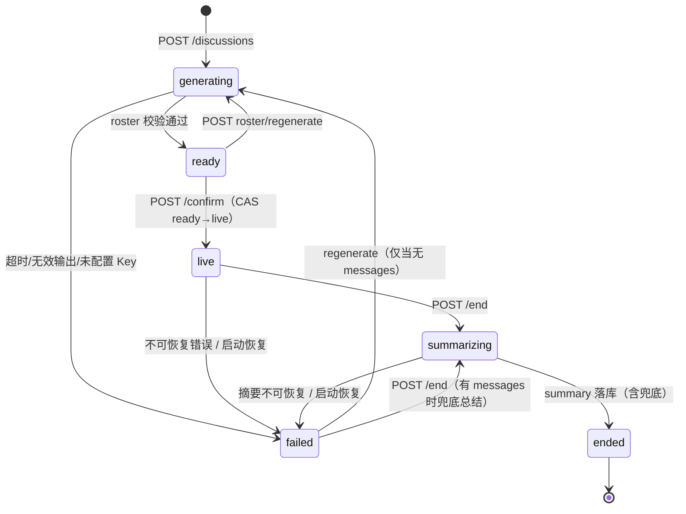

# 后端实施设计 BACKEND-PLAN v0.1

- 日期：2026-10-31
- 状态：G1 设计输入，待 PM 裁决后随契约 v1.0 冻结
- Owner：后端工程师
- 任务：BE-01（只做设计，不写生产代码）
- 关联：[远程作业原文](00-远程作业原文.md)、[PRD](PRD.md)、[ER 图](ER.md)、[API 契约](03-API契约.md)、[SSE 事件契约](04-SSE事件契约.md)、[技术选型](01-技术选型.md)、[角色与协作 SOP](02-角色与协作SOP.md)、[任务板](TASKS.md)

---

## 0. 结论摘要（TL;DR）

1. **契约整体可实现**，技术栈（Node 20 + Fastify 5 + better-sqlite3 + SQLite WAL + SSE）没有任何一项需要更换。`ER.md` 的表结构覆盖了 P0 需要的数据，`03-API契约.md` 的 9 个端点足够走通主链路，`04-SSE事件契约.md` 的 seq / 补发 / 心跳 / delta 语义在 Fastify 上可以干净落地。
2. **但有 6 处必须先改，否则会直接导致 P0 不达标**（详见 §1.4）：
   - **B-01（MUST）**：失败会话没有"终止事件"。`failed` 状态在 SSE 上没有可观察的收尾事件，回放也丢失终态，违反 PRD §10.4「任何 LLM 失败都不能让会话永久卡在 `live`」。建议新增持久化事件 `discussion.failed`。
   - **B-02（MUST）**：`GET /events` 的 `payload` 与 SSE 的 `data` 必须是**同一个对象**。契约没写死这一点，一旦两边形状漂移，ADR-03「直播与回放共用 reducer」立刻失效，且返工跨前端/后端/测试三个角色。建议升级为硬规则。
   - **B-03（MUST）**：`POST /roster/regenerate` 允许 `failed` 状态，但 `failed` 可能已有 messages，替换 experts 会撞 FK 或产生"无主发言"。必须限定"有发言则不可重新生成"。
   - **B-04（MUST）**：`POST /end` 在 `failed` 状态下无路可走，会话变成死胡同（有完整 transcript 但永远不能总结）。建议允许 `failed → summarizing`。
   - **B-05（MUST）**：创建接口没有幂等手段（无 `Idempotency-Key`、无去重窗口），而 FR-02 明确要求"重复提交被阻止"，E2E 也明确要测幂等。
   - **B-06（MUST）**：首页列表的排序规则自相矛盾（"按 updatedAt 倒序" 与 "进行中优先"），且 `status=live` 过滤不覆盖 `generating/ready/summarizing`。分页 + 双排序会导致首页漏卡。
3. **契约里有 1 个真实空洞（不影响跑通但影响 FR-07）**：事件模型无法表达专家的 `preparing` 状态（同一时刻只有一个 speaker，其他人只能是 idle 或由前端在"决策窗口"内推断）。见 §1.3-F7。
4. **最大的 72 小时风险不是 SQLite，也不是 LLM**，而是**事件模型的三方一致性**（seq 语义、payload 形状、终态事件）。它同时牵动前端回放、QA fixture 和后端补发，改一次要动三个人。第二风险是 `SessionRunner` 的 HTTP 生命周期竞态（confirm 立即返回 vs runner 起跑、end 取消在途流、重启恢复）。见 §9。
5. **同步生成阵容可以接受**，但要给它加上"有界等待 + 可重试的失败资源 + `details.discussionId`"三个护栏；异步 + SSE 的替代方案会多花前端 3–5h，不建议在 72h 内切换。

---

## 1. 对现有契约的逐项评审

评级说明：

- **MUST**：不改就无法实现或会导致 P0 验收失败，必须在契约 v1.0 冻结前改。
- **SHOULD**：不改也能跑，但会在 G3/G4 付利息，建议一并改。
- **MAY**：可选，砍掉也不影响验收。

### 1.1 `ER.md` 评审

#### 1.1.1 表与字段

| # | 位置 | 问题 | 结论 | 级别 |
| --- | --- | --- | --- | --- |
| E1 | `discussions.status` | 没有 CHECK 约束；状态枚举只活在文档里，写错一个字母就是脏数据，且会静默卡住状态机 | 加 `CHECK (status IN ('draft','generating','ready','live','summarizing','ended','failed'))` | MUST |
| E2 | `discussions.status` | `draft` 在整条链路里**从未被生产出来**：ER §4.1 建会话直接写 `generating`，API §6 也写"内部 generating"。状态图里的 `draft` 是死状态 | 二选一：删掉 `draft`，或在文档中显式标注"保留但 MVP 不产生"。**建议保留枚举 + 文档标注**（前端已按 PRD 画了状态，删枚举的沟通成本更高） | SHOULD |
| E3 | `discussions.error_code` | 没有枚举，`failed` 的"为什么失败"不可判定，QA 无法断言，前端无法区分"网络超时"和"进程重启中断" | 固定枚举：`INTERRUPTED` / `ROSTER_GENERATION_FAILED` / `LLM_TIMEOUT` / `LLM_INVALID_OUTPUT` / `LLM_NOT_CONFIGURED` / `INTERNAL`；非 `failed` 时恒为 NULL | MUST |
| E4 | `discussions` | 缺 `failure_phase`（失败发生在 roster / turn / summary 哪个阶段），首页文案无法区分"生成失败"和"讨论中断" | 可选加 `TEXT`；MVP 也可由 `error_code` 前缀推断，**建议不加**，用 `error_code` 表达 | MAY |
| E5 | `experts.color` | 字段说明写"十六进制色，唯一"，但**没有 UNIQUE 约束**。FR-03 要求颜色不重复，只能靠应用层校验，DB 无兜底 | 加 `UNIQUE (discussion_id, color)`（注意是会话内唯一，不是全表唯一） | MUST |
| E6 | `experts` | 没有 `persona_json`。AI 角色很可能想给 persona 加声音/性格/忌讳等字段，届时要么改 schema 要么把 prompt 塞进 `stance` | 加 `persona_json TEXT NOT NULL DEFAULT '{}'`，作为 agent 私有字段的逃生口（后端只透传不解析） | SHOULD |
| E7 | `experts.focus` | 语义含糊：是"初始关注点"还是"当前关注点"？如果每轮都更新，`experts` 行会被高频改写，且和 `regenerate` 的替换语义打架 | 定死：`focus` = 当前公开关注点，**可更新**（随该专家发言更新）；为此补 `updated_at TEXT` | SHOULD |
| E8 | `messages.expert_id` | FK 没写删除策略。`regenerate` 要删 experts，默认 `NO ACTION` 会在有发言时抛 FK 错误——这是**好事**，但必须显式声明 | `ON DELETE RESTRICT`（用 DB 层强制"有发言不可换阵容"） | MUST |
| E9 | `messages` | `turn_index` 无唯一约束，也无"是否有空洞"的定义。一跳轮失败就会 `turn_count < max(turn_index)`，前端进度条和 PRD 文案会对不上 | 定死：`turn_index` = 第几次发言尝试（从 1 递增，允许空洞）；`turn_count` = `message.completed` 的条数。**不加唯一约束**（要允许空洞），加 `INDEX (discussion_id, turn_index)` 已有 | MUST |
| E10 | `insights.status` | `active/resolved` **没有出现在 SSE 的 `insight.updated` payload 里**，前端拿不到；而 `insight.updated` 是全量快照，被"解决"的条目直接不出现在快照里就够了 | **删除 `status` 字段**（全量快照语义下它是冗余的） | MUST |
| E11 | `insights` | 没有去重键。全量快照 + LLM 每次重写措辞 = 同一共识反复生成新 id，前端列表跳动、"不重复堆叠"失败 | 加 `content_hash TEXT NOT NULL` + `UNIQUE (discussion_id, type, content_hash)`；后端对归一化文本做 hash，命中即复用旧 id | MUST |
| E12 | `insights` | 没有稳定排序键。契约说按 `updated_at` 排，但每次快照都会刷新 `updated_at`，列表顺序每轮都变 | 定死排序：`ORDER BY created_at ASC`（按首次出现顺序，稳定）；`updated_at` 只做展示。加索引 `(discussion_id, created_at)` | MUST |
| E13 | `insight_evidence` | 只有 `(insight_id, message_id)` 主键，没有 `message_id` 单列索引。"从某条发言反查它支撑了哪些共识"（P1 跳转、QA 断言依据）会全表扫 | 加 `INDEX (message_id)` | SHOULD |
| E14 | `events` | 只有 `UNIQUE(discussion_id, seq)` 和 `(discussion_id, type)`。`GET /events?after=seq` 是最高频查询，靠唯一索引已可覆盖，够用 | 无需改；补 `CHECK (seq > 0)` | MAY |
| E15 | `summaries` | 无 `is_fallback`。LLM 总结失败时必须降级为模板文案（AR-09 / FR-15），但事后无法区分"模型写的"和"兜底的" | 加 `is_fallback INTEGER NOT NULL DEFAULT 0` | SHOULD |
| E16 | 全局 | 没有 `schema_migrations` 表，`pnpm db:migrate` 无法幂等 | 新增 `schema_migrations(version INTEGER PRIMARY KEY, name TEXT, applied_at TEXT, checksum TEXT)` | MUST |

#### 1.1.2 索引

现有索引基本够用。补一条首页查询的复合索引即可：

```sql
CREATE INDEX idx_discussions_list ON discussions(status, updated_at DESC);
```

首页排序实际形态（见 B-06 建议）是"未结束优先 + updated_at 倒序"，用 `status IN (...)` + `updated_at DESC` 的组合，上面这个索引 SQLite 会走 `updated_at` 部分；数据量在 50 条量级，**不构成性能问题**，加它是为了给未来留退路，不是瓶颈。

#### 1.1.3 事务

| # | 位置 | 问题 | 结论 | 级别 |
| --- | --- | --- | --- | --- |
| T1 | ER §4.1 伪代码 | **自相矛盾**：伪代码 `BEGIN` 之后第一行就是"调 LLM 生成阵容（不放在事务里）"。照抄这段会写出"把 12 秒的 LLM 调用包在事务里"，直接锁死写库 | 改写为三段：① `INSERT discussions(status='generating')` + `INSERT events(discussion.created)` 提交；② 事务外调 LLM；③ 一个短事务写 experts + `roster.ready` + `status='ready'` | MUST |
| T2 | ER §4.2 | 没写 `insight.updated` 的事务边界，也没写它和 `message.completed` 的先后 | 定死：每个 `insight.updated` 独立短事务，**不得**与 `message.completed` 合并在一个事务里（否则共识提炼变慢会拖住发言落库） | SHOULD |
| T3 | ER §4.3 | 结束流程 `UPDATE status=summarizing` 后调 LLM，此时进程崩溃 → 永久 `summarizing`（重启恢复兜住了，但文档没写恢复规则） | 见 §3.6，重启时 `summarizing → failed(INTERRUPTED)` | MUST |
| T4 | ER §6 | "事件 seq 用会话级计数器 + 唯一索引兜底；冲突时重试一次"——在单进程 + better-sqlite3 同步事务下**不可能冲突**，这句话会误导实现者去写重试循环（然后引入重复 seq 的 bug） | 改写：seq 在写事务内用 `SELECT COALESCE(MAX(seq),0)+1` 分配，同一事务内插入；唯一索引只作不变式断言，不写重试逻辑 | MUST |
| T5 | ER §6 | 没写 `PRAGMA foreign_keys=ON` 是**每连接**生效（重启连接就失效），只写一条会外键静默失效 | 明确：每次 open 连接后立即设置 4 条 pragma | MUST |

#### 1.1.4 ER §8「待后端确认」的逐条回答

1. **`payload_json` 只存语义事件、`message.delta` 不落库**：✅ 确认。补一条推论必须写进契约——**崩溃时可能存在"有 `turn.started` 但永远没有 `message.completed`"的悬挂轮次**，回放和前端必须容忍（见 §1.3-B/T7）。
2. **`last_seq` 由 discussions 维护还是查 MAX(seq)**：✅ 两者都用，但只有一个是权威。**权威 = `MAX(seq)`**，在写事务内与插入同源；`discussions.last_seq` 是同一事务内写下的缓存，仅供列表查询和 `stream.ready` 快速读取。启动时做一次 `last_seq = MAX(seq)` 修复（见 §4.5）。理由：一次索引 seek 的成本远低于一次数据漂移的排查成本。
3. **`insights` 全量替换还是增量 upsert**：✅ **投影按"全量快照"处理，DB 按 upsert + 差集删除**。同一事务内：① 对快照中每条按 `(discussion_id,type,content_hash)` upsert，复用旧 `id`；② 收集保留的 id；③ 删除不在快照里的 `insight_evidence` 和 `insights`。这样 DB 的 `insights` 表 = 最新快照，和前端 reducer 的行为完全一致。
4. **`failed` 还是 `interrupted`**：✅ **状态值统一用 `failed`，用 `error_code='INTERRUPTED'` 区分进程重启**。不新增状态值（少一个状态，前端/QA 的矩阵少一行）。
5. **`discussion_settings` 表**：✅ **不做**，模型/轮次/超时全部走环境变量（见 §7.2）。

### 1.2 `03-API契约.md` 评审

#### 1.2.1 端点与语义

| # | 端点 | 问题 | 结论 | 级别 |
| --- | --- | --- | --- | --- |
| A1 | `POST /api/discussions` | **无幂等**。FR-02 要求"重复提交被阻止"，但接口层没有任何去重手段；双标签页、双击、E2E 重放都会造出两条讨论和两次 LLM 费用 | 加可选请求头 `Idempotency-Key`；缺省时服务端对 `(topic 归一化, expertCount)` 在 `generating` 状态内做 10s 去重窗口，命中返回 **200**（而非 201）+ 已有资源 | MUST |
| A2 | `POST /api/discussions` | 同步生成（最长 20s）没有"有界等待"说明，也没说超时后 `discussion` 的最终状态 | 明确：服务端硬超时 20s（= `ROSTER_TIMEOUT`，含 1 次修复重试；HTTP 层整体预算 22s）；超时/失败时资源必定落为 `failed` 且 `details.discussionId` 必返，前端可原地重试 | MUST |
| A3 | `POST /api/discussions` | 502/504 返回时资源已创建，但响应体是错误形状——调用方无法区分"没建成"和"建成了但失败" | 已用 `details.discussionId` 缓解；**要求该字段在 502/504 中必定存在**，并写进契约 | MUST |
| A4 | `POST /roster/regenerate` | "仅 ready/failed 可调用" + "替换旧阵容"。`failed` 若有 messages，`DELETE experts` 直接撞 FK（E8）或产生无主发言 | 收紧为：`status ∈ {ready, failed}` **且 `messages` 为空**才可重生成；否则 `409 INVALID_STATE`。DB 层用 RESTRICT 兜底 | MUST |
| A5 | `POST /roster/regenerate` | 没有并发互斥。两个并发请求会发两次 LLM、写两个 `roster.ready`，最后写赢 | 复用 `generating` 状态作为互斥：CAS `ready/failed → generating`，成功后回 `ready`，失败回滚到 `ready`（有旧阵容）或 `failed`（无阵容） | SHOULD |
| A6 | `POST /confirm` | 幂等返回 200、首次返回 202——同一端点两个成功码，测试矩阵要写两遍。真正的问题是**没写幂等靠什么实现**：读-判断-写会在并发下启动两个 runner | 保留 202/200 双码（无伤大雅），但契约必须写明**用条件 UPDATE 做 CAS**：`UPDATE discussions SET status='live' WHERE id=? AND status='ready'`，以 `changes===1` 判定"我赢得了启动权" | MUST |
| A7 | `POST /end` | `failed` 无法结束（见 B-04）。有完整 transcript 的失败会话永远不能出总结，FR-10/FR-13 落空 | 允许 `failed → summarizing`（仅当有 messages）；summary 走兜底模板，`summaries.is_fallback=1` | MUST |
| A8 | `POST /end` | "summarizing / ended 幂等返回当前状态（200/202）"——两个码，且没说 `summarizing` 卡住时怎么办 | 统一回 **202**；`summarizing` 若内存中无摘要任务在跑，本次请求重新触发一次摘要（用户主动重试，不算"自动重跑 LLM"） | SHOULD |
| A9 | `POST /end` | "正在流式输出的消息允许完成或中止"——**没规定选哪个**，于是实现者随便选，回放里就可能出现悬挂 `turn.started` | 定死：收到 end 后给在途发言 **3s 宽限**；3s 内完成则正常落 `message.completed`，否则 abort 并**丢弃该轮**（不落半条消息），前端规则见 §1.3-T7 | MUST |
| A10 | `GET /discussions` | `status` 过滤只有 `all/live/ended/failed`，但真实状态有 7 个。`generating/ready/summarizing` 归到哪？首页会漏卡 | 改为语义分组：`status=active`（= generating/ready/live/summarizing）∪ `ended` ∪ `failed` ∪ `all`；同时保留 `status=<具体状态>` 精确过滤 | MUST |
| A11 | `GET /discussions` | 排序自相矛盾（§5 同时写"按 updatedAt 倒序"和"进行中优先，其次最近结束"） | 定死 SQL：`ORDER BY (status IN ('ended','failed')) ASC, updated_at DESC, id ASC`——未结束优先、同级按更新时间倒序、`id` 做稳定 tiebreak（分页防重） | MUST |
| A12 | `GET /discussions` 响应 | `expertCount: 4` 但 `experts` 只给了 2 个。是截断？还是失败态？前端头像组会画错 | 定死：**列表返回全部 `1+expertCount` 人**（最多 7 个对象，50 条列表可接受）；`expertCount` 恒等于"请求的专家数 N"，`experts.length` 恒等于"实际人数"（失败时为 0） | MUST |
| A13 | `GET /discussions` 响应 | `failed` 卡片没有 `errorCode`，首页无法区分"生成失败"和"中断"（FR-15 要可读状态） | 列表项和详情各加 `errorCode: string|null`，不透传 `error_message` | MUST |
| A14 | `GET /discussions/:id` 响应 | `lastSeq` 在顶层和 `discussion.lastSeq` 重复 | 冗余但无害，保留（前端直播页直接读顶层更顺手） | MAY |
| A15 | `GET /discussions/:id/events` | 假设 `payload` 与 SSE `data` 不同源，回放 reduce 就要写两套 → ADR-03 失效 | **硬规则**：`payload_json` 存的就是 SSE `data` 对象本身，`GET /events` 原样返回（见 B-02） | MUST |
| A16 | `GET /events` 响应 | `lastSeq` 语义不明（是"本页最后一条"还是"会话最后一条"） | 定死：`lastSeq` = 会话当前 `last_seq`；翻页用**最后一条 item 的 `seq`** | SHOULD |
| A17 | `GET /stream` | 404 时返回 JSON，但浏览器的 `EventSource` **读不到错误响应体**，只会触发 `onerror` 并自动重连 → 不存在的 id 会产生无限重连 | 契约写明：客户端**必须先 GET 详情成功后再建流**；服务端对未知 id 返回 404 JSON；前端禁止在 404 后重连 | MUST |
| A18 | `GET /stream` | 已结束会话"补发到结尾后关闭" → 客户端看到连接关闭会**自动重连**，而重连后又立刻关闭，形成死循环 | 依赖已存在的 `stream.ready.status`：客户端在 `stream.ready` 里看到 `ended`/`failed` 时**立即 `close()` 且不重连**。这条必须写进契约（后端配合：终态时 `stream.ready` 必须带对的 status） | MUST |
| A19 | 全局 | 缺 `PAYLOAD_TOO_LARGE`（413）与 `LLM_NOT_CONFIGURED`（503）。前者是 Fastify 的 `bodyLimit` 默认行为，不映射就会漏出 `FST_ERR_CTP_BODY_TOO_LARGE`；没有 Key 时后端应给出可读错误而不是 500 | 错误码表补 2 行；错误处理器统一把 Fastify 内置错误码映射到 `VALIDATION_ERROR`/`PAYLOAD_TOO_LARGE` | MUST |
| A20 | 全局 | 错误体无 `requestId`。NFR-09 要求可观测，"用户报错时后端能定位那一 request"是刚需，且不涉及敏感信息 | 错误体加 `requestId: string`（= `request.id`） | SHOULD |
| A21 | 全局 | 缺失败注入钩子。QA 要测"LLM 超时/无效 JSON/空输出"三条降级路径，没有钩子就只能打真实模型赌运气 | 仅当 `LLM_MODE=mock` 时接受请求头 `x-mock-scenario: timeout\|invalid-json\|empty\|http500\|slow`（白名单，非 mock 模式忽略并记日志） | MUST |

#### 1.2.2 状态码与幂等总表（后端要实现的目标矩阵）

| 操作 | draft | generating | ready | live | summarizing | ended | failed |
| --- | --- | --- | --- | --- | --- | --- | --- |
| confirm | 409 | 409 | **202** | 200（幂等） | 409 | 409 | 409 |
| roster/regenerate | 409 | 409（互斥生效） | **200** | 409 | 409 | 409 | 200 仅当无 messages，否则 409 |
| end | 409 | 409 | 409 | **202** | 202（可重试摘要） | 202（幂等） | 202 仅当有 messages，否则 409 |
| 未知 id | 一律 404 `NOT_FOUND`，且 `POST /stream` 同样 404 | | | | | | |

> 这张表就是 §8 接口测试的用例矩阵来源，**每一格都要有一条测试**。

### 1.3 `04-SSE事件契约.md` 评审

#### 1.3.1 seq

| # | 问题 | 结论 | 级别 |
| --- | --- | --- | --- |
| S1 | `seq` 分配规则只在 ER 里，SSE 契约没写"seq 连续且无空洞"这个不变式；前端 §5.5 却依赖"发现跳号就重新拉" | 明确不变式：**同一会话的持久化事件 seq 从 1 开始严格连续**（由单进程同步事务保证）。跳号只可能来自前端漏收，不可能来自服务端。前端补洞逻辑因此是"防御性"的，不是常规路径 | SHOULD |
| S2 | `stream.ready` 无 `id` 但不落库，于是它不占 seq——正确。但契约没说"补发事件的 `id` 必须严格递增" | 补一条：同一连接内 `id` 单调递增；客户端以 `lastAppliedSeq` 为唯一进度指针 | SHOULD |

#### 1.3.2 补发

| # | 问题 | 结论 | 级别 |
| --- | --- | --- | --- |
| S3 | §5 的握手顺序（ready → 补发 → 实时）**没有规定"订阅与补发之间不能有空洞"**。教科书级事故：先读库再订阅，这期间的 2 条事件永远丢 | 实现规则写死：**先挂订阅（进入缓冲），再同步读库补发，再同步 flush 缓冲（`seq > 已发送`）**。因为 `appendEvent` 是同步函数、补发全程无 `await`，中间不可能插入新事件——空洞在单进程内被结构性消除（见 §5.2） | MUST |
| S4 | 没写 `after` 与 `Last-Event-ID` 同时出现且互不相等时的行为 | 保留 `max()`，但要写清理由：`after` 是客户端首次连接的意图，`Last-Event-ID` 是浏览器重连时更"新"的进度，取大者不会重发已确认事件 | SHOULD |
| S5 | 没写"客户端 `after` 大于服务端 `lastSeq`"（例如换了数据库 / 换了机器）怎么办 | 服务端不退化为挂起：正常发 `stream.ready{lastSeq}`，不补发任何事件，并让客户端用 `details` 校准。建议 `stream.ready` 增加 `fromSeq`（服务端实际采用的起点），客户端据此判断是否需要重拉 | SHOULD |
| S6 | 没写 `retry:` 帧。浏览器默认重连间隔约 3s 且不可控，NFR-02 要求"断线 3s 内自动重连" | 连接建立后立即写 `retry: 1000\n\n`，把重连节奏握在服务端手里 | SHOULD |

#### 1.3.3 心跳

| # | 问题 | 结论 | 级别 |
| --- | --- | --- | --- |
| S7 | 15s 心跳对本地没问题，但**没有"心跳写失败即判定断线"的规则**：客户端已消失但 socket 未报错时，定时器会一直写 | 实现规则：`res.write()` 返回 false 且 `writableLength` 超阈值、或 write 抛错 → 立即 `destroy()` 并清理订阅。心跳兼作"活性探针" | SHOULD |
| S8 | 没有写"心跳不计入 seq、不影响 `Last-Event-ID`" | 补一句（注释帧本来就没有 id，但要防实现者手滑写成 `id:` 帧，那会把客户端的进度指针污染成 `NaN`） | MUST |

#### 1.3.4 `message.delta` / `message.completed`

| # | 问题 | 结论 | 级别 |
| --- | --- | --- | --- |
| D1 | 契约没说 `message.delta.messageId` **就是最终的 `messages.id`**。如果是临时 id，前端占位消息和最终消息的 key 不一致，`completed` 到达时会闪一下/重复一条 | 硬规则：`messageId` 在 `turn.started` 之后、首个 delta 之前由服务端生成，**全程不变**，即最终持久化的 `messages.id` | MUST |
| D2 | `turn.started` 不带 `messageId`，客户端得靠"第一帧 delta"去关联占位 | 可选：`turn.started` 增加 `messageId`（服务端在开轮时就生成 id）。成本 0，收益是前端不用猜。**建议加** | SHOULD |
| D3 | 补发期间到达的 delta 怎么办（补发的是持久化事件，delta 是实时的） | 实现规则：**补发阶段丢弃所有 delta**；已发过 `message.completed` 的 `messageId` 之后的 delta 也丢弃。理由：delta 永远可由 completed 重建，反之不行 | MUST |
| D4 | `message.completed` 的 `content` 长度约束（AR-04 ≤120 字）没写谁来截断 | 定死：**服务端截断**（按句末标点截，绝不硬切半个 JSON/半句话），`char_count` 落库供 QA 断言。agent 负责"写短"，服务端负责"保底不长" | SHOULD |
| D5 | 没写"一轮 delta 之后网络断了、消息没完成"的最终形态 | 见 T7：该轮**不存在**（没有 message 行、没有 completed 事件），前端在收到终态或重连后必须清空未完成缓冲 | MUST |

#### 1.3.5 终态与失败

| # | 问题 | 结论 | 级别 |
| --- | --- | --- | --- |
| T6 | **`error` 事件不落库、不带 id、`recoverable=false` 时也没有任何持久化终态事件**。已连接的客户端只能靠一条瞬态 error 猜状态；重连的客户端则永远看到 `live`。回放里失败会话没有任何收尾 → 违反 PRD §10.4 | 新增持久化事件 **`discussion.failed`**，`seq` 参与编号，payload `{discussionId, code, message, endedAt}`，是终态事件；`discussion.ended` 与它互斥且都只能是最后一条持久化事件 | MUST |
| T7 | 悬挂 `turn.started`（abort / 崩溃 / end 打断）在契约里没有名字，回放映射表也没有对应行 | 补一条显式规则：**`turn.started` 之后没有 `message.completed` 即视为该轮被中断**；前端必须在收到 `summary.completed` / `discussion.ended` / `discussion.failed` 或重连后的 `stream.ready` 时清空"发言中"状态。回放时跳过该轮（不渲染空消息）。**另**：`AGENT-BEHAVIOR.md` §1.2 的时序图里已经画出了 `turn.aborted`，说明 Agent 侧已假定该事件存在 → 建议按 B-20 补为**持久化事件**（payload `{discussionId, turnIndex, speakerId, reason}`），语义 = "本轮开始了但没有成品"。这样前端不必靠推断、QA 可以断言语义；而崩溃场景（来不及写 aborted）仍靠上面的"无 completed 即中断"规则兜底 | MUST |
| T8 | `error` 事件的 `recoverable=false` 分支说"会话进入 failed/ended 的可读状态"，但没说进入哪个、由谁写 | 定死：`recoverable=false` → 服务端写 `discussion.failed` + `discussions.status='failed'` + `error_code`，然后关闭该会话所有 SSE 连接 | MUST |
| T9 | `insight.updated` 允许"异步、可能稍后"，但没写"必须早于终态事件"，也没写"快照没变就不发" | 定死两条：① 发终态前必须 flush 挂起的洞察任务（上限 3s，超时则丢弃并记日志）；② **快照内容 hash 与上次相同时不发事件**（否则 10 轮产生 10 条一模一样的 `insight.updated`，前端动画闪 10 次） | MUST |

#### 1.3.6 其他空洞

| # | 问题 | 结论 | 级别 |
| --- | --- | --- | --- |
| F7 | **FR-07 要求专家状态 `idle/preparing/speaking`，但事件模型只能推出 `speaking`（`turn.started`→`message.completed`）和"非 speaking"**。没有任何事件能表达"某位专家正在准备发言"，而 FR-07 是 P0 | 两个方案：**(a) 前端派生**（推荐，零契约成本）：`live` 且无活动轮次 ⇒ 所有专家 `preparing`（正在决策下一位）；有活动轮次 ⇒ 该轮 speaker `speaking`、其余 `idle`。**(b) 后端新增 `turn.deciding` 事件**（成本 +1 事件 +契约改动 +QA 用例）。建议 (a)，并在 SSE 契约里补一节"派生状态规则"，由 PM 与前端确认 | MUST（规则必须定，方案可选） |
| F8 | 每轮结束都要更新"当前共识/分歧"，但 `insight.updated` 是全量快照，MVP 下 20 条以内的 payload 约 3–6KB，每轮一次，20 个连接 × 10 轮 = 1.2MB 广播量 | 可接受，不必改。但建议服务端把 `insights` 序列化一次复用（不要每个连接各自 `JSON.stringify`） | MAY |
| F9 | 契约没写结束会话后 SSE 连接**何时**关闭（"补发到结尾后关闭"，如果客户端本来就追平了则立刻关） | 定死：写完 `discussion.ended`/`discussion.failed` 后 `res.end()`，并在下一 tick 清理订阅与心跳定时器 | SHOULD |
| F10 | 没有"同一会话多标签页"的连接数上限。NFR-03 要 20 个连接，但没有边界，恶意/失控标签页会堆积 | 每会话最多 32 个订阅，超出按最旧淘汰（关闭）并记 warn。MVP 不做认证，这只是防呆 | MAY |

### 1.4 契约修改建议汇总（PM 可直接裁决）

> 下面每条都是**可执行条目**：给出现状、建议动作、影响文件、估算成本。"必须"= 不改则 P0 有硬伤。

| ID | 级别 | 建议动作 | 影响文档 | 成本 |
| --- | --- | --- | --- | --- |
| B-01 | **必须** | 新增持久化终态事件 `discussion.failed`（含 `code/message/endedAt`），写入 SSE 事件总表、事件定义、回放映射表、`GET /events` 语义；`error` 事件保持瞬态不落库 | `04-SSE事件契约.md`、`03-API契约.md`、`ER.md` | 0.5h |
| B-02 | **必须** | 写死"`events.payload_json` = SSE `data` 对象本身，`GET /events` 原样返回 `payload`"，并作为 ADR-03 的实现前提 | `04-SSE事件契约.md`、`03-API契约.md` | 0.2h |
| B-03 | **必须** | `regenerate` 增加"`messages` 为空"前置条件；`messages.expert_id` 用 `ON DELETE RESTRICT` | `03-API契约.md`、`ER.md` | 0.2h |
| B-04 | **必须** | `POST /end` 允许 `failed → summarizing`（仅当有 messages），摘要走兜底、`is_fallback=1` | `03-API契约.md`、`ER.md` | 0.3h |
| B-05 | **必须** | `POST /discussions` 支持 `Idempotency-Key`；缺省时 `(topic, expertCount)` 在 `generating` 内 10s 去重，命中回 200 | `03-API契约.md` | 0.3h |
| B-06 | **必须** | 首页列表排序定死为 `(status IN ('ended','failed')) ASC, updated_at DESC, id ASC`；`status` 过滤改为 `active/ended/failed/all` 语义分组 + 支持精确状态 | `03-API契约.md` | 0.2h |
| B-07 | **必须** | 列表项返回**全部** experts，并新增 `errorCode` 字段；明确 `expertCount` = 请求数、`experts.length` = 实际人数 | `03-API契约.md` | 0.2h |
| B-08 | **必须** | `POST /end` 的在途发言处理定死：3s 宽限，超时 abort 并丢弃该轮 | `03-API契约.md`、`04-SSE事件契约.md` | 0.2h |
| B-09 | **必须** | 补"悬挂 `turn.started`"规则：无 `message.completed` 即视为中断，前端在终态/重连时清除 speaking 状态 | `04-SSE事件契约.md` | 0.2h |
| B-10 | **必须** | 补"终态后不重连"规则：客户端依据 `stream.ready.status` 判定 `ended/failed` 后立即 `close()`；`stream` 端点对未知 id 返回 404 JSON | `04-SSE事件契约.md`、`03-API契约.md` | 0.2h |
| B-11 | **必须** | `message.delta.messageId` 定死为最终 `messages.id`（可选：`turn.started` 增加 `messageId`） | `04-SSE事件契约.md` | 0.2h |
| B-12 | **必须** | 错误码表补 `PAYLOAD_TOO_LARGE(413)`、`LLM_NOT_CONFIGURED(503)`；错误体加 `requestId` | `03-API契约.md` | 0.2h |
| B-13 | **必须** | 仅 mock 模式有效的测试钩子 `x-mock-scenario`（timeout/invalid-json/empty/http500/slow），供 QA 打失败路径 | `03-API契约.md`（或 QA-PLAN 备注） | 0.2h |
| B-14 | **必须** | ER：删 `insights.status`；`insights` 加 `content_hash` + UNIQUE；排序定死 `created_at ASC` | `ER.md`、`04-SSE事件契约.md` | 0.3h |
| B-15 | **必须** | ER：补 `schema_migrations` 表、`experts` 颜色会话内唯一、`discussions.status` CHECK、`error_code` 枚举、`experts.updated_at` | `ER.md` | 0.3h |
| B-16 | 建议 | ER：修正 §4.1 事务伪代码（LLM 不在事务内）、§6 seq 冲突描述 | `ER.md` | 0.1h |
| B-17 | 建议 | ER：`experts` 加 `persona_json`；`summaries` 加 `is_fallback`；`insight_evidence` 加 `message_id` 索引 | `ER.md` | 0.2h |
| B-18 | 建议 | SSE：`retry: 1000`、`stream.ready` 增加 `fromSeq`、`insight.updated` 内容未变不发、终态前 flush 上限 3s、每会话 32 连接上限 | `04-SSE事件契约.md` | 0.3h |
| B-19 | 建议 | SSE：补一节"派生状态规则"（idle/preparing/speaking 如何从事件推出），解决 FR-07 | `04-SSE事件契约.md`、`PRD.md` §7 | 0.3h |
| B-20 | 建议 | 新增持久化事件 `turn.aborted`（`{discussionId, turnIndex, speakerId, reason}`，`reason ∈ user_end/llm_timeout/guard_rejected/watchdog`）；`AGENT-BEHAVIOR.md` §1.2 已假定其存在，不补则 AI 文档与 SSE 契约不一致 | `04-SSE事件契约.md`、`ER.md` §5 事件表 | 0.3h |

**总改动量估计：契约文档 2–3 小时（PM 侧），后端/前端/QA 各增加约 1–2h 实现成本，换取的是 G4 联调阶段少一轮返工。强烈建议在 G1 一次改完。**

---

## 2. 模块与目录

### 2.1 `apps/server` 目录结构

```text
apps/server/
├── package.json
├── tsconfig.json
├── src/
│   ├── index.ts                    # 进程入口：loadEnv → openDb → migrate → buildApp → listen → 优雅退出
│   ├── app.ts                      # buildApp(deps): FastifyInstance（测试用 inject 直接调）
│   ├── config/
│   │   ├── env.ts                  # Zod 校验环境变量；Key 只在此处出现，禁止外泄
│   │   └── constants.ts            # 超时/轮次上限/心跳间隔等（可被测试覆盖）
│   ├── http/
│   │   ├── errors.ts               # AppError + ERROR_STATUS 映射（唯一错误出口）
│   │   ├── error-handler.ts        # setErrorHandler：AppError/Fastify 内置错误/Zod/未知
│   │   ├── schemas.ts              # 从 packages/shared 引入，此处只做组装，不重复定义
│   │   └── plugins/
│   │       ├── request-context.ts  # requestId、结构化日志、脱敏
│   │       └── cors.ts             # 仅 dev 的 localhost:5173
│   ├── db/
│   │   ├── connection.ts           # better-sqlite3 打开 + 4 条 pragma + close
│   │   ├── migrate.ts              # 读 migrations/*.sql，按 version 顺序执行，写 schema_migrations
│   │   ├── migrations/
│   │   │   ├── 0001_init.sql
│   │   │   └── 0002_seed_support.sql
│   │   ├── seed.ts                 # 5 条样例；**通过事件写入 → 投影重建**，保证可回放
│   │   └── seed/fixtures/
│   │       ├── 01-ai-jobs.ts
│   │       ├── 02-remote-work.ts
│   │       ├── 03-live-debate.ts
│   │       ├── 04-ready-roster.ts
│   │       └── 05-failed-generation.ts
│   ├── repositories/
│   │   ├── discussions.repo.ts     # 全部方法首参 discussionId 或显式 id；禁止无界查询
│   │   ├── experts.repo.ts
│   │   ├── messages.repo.ts
│   │   ├── insights.repo.ts
│   │   ├── events.repo.ts          # append(seq 分配)、listAfter、getLastSeq、repair
│   │   └── summaries.repo.ts
│   ├── services/
│   │   ├── discussion.service.ts   # create / get / list / confirm / end / regenerate 的编排 + CAS
│   │   ├── roster.service.ts       # 生成 → 校验 → 落库三段式
│   │   ├── event.service.ts        # ★ 唯一写入口：appendEvent（sync）→ 落库 → 广播
│   │   ├── insight.service.ts      # 快照 diff / upsert / 事件 payload 生成
│   │   └── summary.service.ts      # LLM 摘要 + 兜底模板
│   ├── session/
│   │   ├── session-manager.ts      # Map<discussionId, SessionRunner>；start/stop/stopAll/recover
│   │   ├── session-runner.ts       # ★ 状态机 + 轮次循环 + AbortController
│   │   ├── insight-worker.ts       # 每会话 1 个，合并触发、最多 1 个在途
│   │   ├── broadcaster.ts          # ★ 每会话订阅集合，seq 顺序扇出，delta 合帧
│   │   └── snapshot.ts             # buildSessionSnapshot(id) → SessionSnapshot（给 agent）
│   ├── llm/
│   │   ├── types.ts                # LLMClient 接口
│   │   ├── deepseek.ts             # openai SDK + baseURL + 关闭 thinking + 流式
│   │   ├── mock.ts                 # 确定性 mock + 场景注入
│   │   └── factory.ts              # 按 env 选择；测试直接注入
│   ├── lib/
│   │   ├── ids.ts                  # uuid / 确定性 event id
│   │   ├── clock.ts                # nowIso()（测试可冻结）
│   │   ├── text.ts                 # 截断到句末、normalize、hash
│   │   └── logger.ts               # pino + redact(sk-…)
│   └── types/
│       └── internal.ts             # 仅服务端使用的 DTO（不导出到 shared）
└── test/
    ├── unit/
    ├── api/
    └── integration/
```

### 2.2 分层与依赖规则（强约束）

```text
routes  →  services  →  repositories  →  db
   ↓          ↓
  http     session / llm
   ↓          ↓
        packages/shared（类型与 Zod）
        packages/agent （纯函数，无 IO）
```

规则：

1. **routes 不碰 SQL**，只做：解析（Zod）→ 调 service → 组装响应。异常一律 `throw new AppError(code, message, details)`。
2. **repositories 不含业务判断**，方法签名必须带会话维度：`findMessages(discussionId, {limit})`；**禁止** `findAll()`、`getByStatus()` 这类跨会话读（ER §6 已定，代码走查执行）。
3. **services 不碰 HTTP**，不读 `request`；成功/失败用返回值和 `AppError` 表达。
4. **`appendEvent` 是唯一的事件写入口**（`services/event.service.ts`），内部完成：分配 seq → 写 `events` → 写投影 → 更新 `discussions` → 广播。任何绕过它直接 `INSERT events` 的代码都视为 bug。
5. **禁区内禁止 `await`**：`appendEvent` 及其内部事务必须是**同步函数**。这是 §4 并发正确性的基石，也是 `/api/*.ts` 里唯一允许出现的同步 DB 调用点。
6. **禁止在 `apps/server` 里写 prompt 字符串**（SOP §11）：prompt 全部来自 `packages/agent`；后端只拼接 messages 数组和参数。

### 2.3 与 `packages/shared` 的边界（PM owner）

后端**只消费、不定义**：

| shared 导出 | 后端用途 |
| --- | --- |
| `DiscussionStatus` / `ExpertRole` / `InsightType` / `Intent` 枚举 | DB CHECK、状态机、映射 |
| `ApiErrorCode` + `ERROR_HTTP_STATUS` | 错误处理器唯一真相源 |
| `SseEventType` 联合类型 + 每种事件的 `payloadSchema` | 写入前 `parse`、广播前 `parse` |
| `CreateDiscussionRequest` / `DiscussionDetail` / `DiscussionListItem` … | 路由层的 `schema` 与响应类型 |
| 事件 payload 的 TS 类型（由 zod 推导） | repository 的 `JSON.parse` 结果标注 |

**硬规则**：后端不得在 `apps/server` 里重新声明一份同名字段/事件 payload。如果发现 shared 缺字段，走 PM 变更，不在后端"先加一个 optional 用着"。这条是"接口漂移"（SOP §11）的唯一防线。

### 2.4 与 `packages/agent` 的接口边界（AI/Agent owner）

SOP §4.1 已给出建议签名。后端在此基础上**补全并冻结**如下（G1 需 AI 角色确认）：

```ts
// packages/agent —— 纯函数，不得 import fastify / better-sqlite3 / fs / http
export const PROMPT_VERSION: string;

export interface PromptSpec {
  system: string;
  user: string;
  responseFormat: 'text' | 'json_object';
  temperature: number;
  maxOutputTokens: number;
}

export function buildRosterPrompt(i: { topic: string; expertCount: number }): PromptSpec;
export function parseRoster(raw: string): RosterDraft;              // 失败抛 AgentParseError
export function validateRoster(d: RosterDraft, n: number): RosterIssue[]; // 空数组=通过

export function assembleContext(s: SessionSnapshot, budget: TokenBudget): ContextBundle;
export function buildDecisionPrompt(c: ContextBundle): PromptSpec;
export function parseDecision(raw: string): TurnDecision;
export function buildSpeechPrompt(c: ContextBundle, d: TurnDecision): PromptSpec;

export function buildInsightPrompt(c: ContextBundle): PromptSpec;
export function parseInsight(raw: string): InsightDraft[];

export function buildSummaryPrompt(c: ContextBundle): PromptSpec;
export function parseSummary(raw: string): { content: string };

// 兜底（后端在失败路径直接调用，不经过 LLM）
export function selectFallbackSpeaker(s: SessionSnapshot): TurnDecision;
export function fallbackSpeech(s: SessionSnapshot, d: TurnDecision): string;
export function fallbackSummary(s: SessionSnapshot): string;
```

**与 `AGENT-BEHAVIOR.md` 的实际对齐**（该文档已产出，组件名为 `RosterBuilder` / `ContextAssembler` / `Scheduler` / `DecisionMaker` / `SpeechWriter` / `HostWriter` / `InsightExtractor` / `Summarizer` / `Guards` / `Validators` / `LLMAdapter`）：

后端**不关心** agent 内部怎么分层，只依赖 4 类能力，缺一不可：

| 能力 | 后端调用点 | 若 agent 未提供 |
| --- | --- | --- |
| 建 prompt（5 种） | 每次 LLM 调用前 | 后端无法开工（禁止在 server 里写 prompt） |
| parse + validate（Zod 之外的语义校验） | LLM 返回后、落库前 | 后端退化为只做 Zod 结构校验，行为质量交给 AI 侧 eval |
| 降级（`selectFallbackSpeaker` / `fallbackSpeech` / `fallbackSummary`） | 三类失败路径 | 后端用"最短上下文 + 上一位发言者"的裸兜底（质量差但能跑） |
| `PROMPT_VERSION` 常量 | 写入日志与事件（便于回溯） | 记 `unknown` |

后端按 `AGENT-BEHAVIOR.md` 的常量表执行运行时配置：`SESSION_WATCHDOG=90s`（无新持久化事件 → 强制收尾）、`LLM_CONCURRENCY_GLOBAL=4`、`SUMMARY_TIMEOUT`——这些属于**后端执行**项，与本文 §7.2 一致。

**边界裁决（需 PM 拍板，半小时内定，否则会写出两套 HTTP 客户端）**：

`AGENT-BEHAVIOR.md` §1.1 把 `LLMAdapter`（含请求/流式/超时/剥离 `reasoning_content`）定义在 `packages/agent` 内并标注为"唯一 IO"；SOP §3.2 把"LLM adapter"写在 AI 角色名下。但 SOP §3.4 又把"LLM 调用运行时：超时、重试、限流、错误映射"和"服务端 Key 加载"划给后端。三处说法冲突。

**建议裁决（成本最低、安全边界最清）**：

| 归属 | 内容 | 理由 |
| --- | --- | --- |
| `packages/agent/src/llm/types.ts` | `LLMClient` **接口定义** | 双方都要 import，放 agent 侧不破坏依赖方向 |
| `packages/agent/src/llm/mock.ts` | mock 实现（纯内存、零 IO、确定性） | `evals/` 必须脱离服务端独立跑，且本来就不该烧真钱 |
| `apps/server/src/llm/deepseek.ts` | **DeepSeek HTTP 实现（唯一的真实 IO）** | Key 只在服务端出现（SOP §11、NFR-06）；超时/重试/限流/错误映射归后端（SOP §3.4） |
| `apps/server/src/llm/factory.ts` | 按 env 选择实现 + 注入 signal/timeout/model | 策略归后端，实现可替换 |

即：**"agent 内不出现第二个网络调用"这个目标可以达成，但不需要 agent 自己发 HTTP**。如果 PM 决定反过来（真实 adapter 放 agent），后端唯一要求是：adapter 必须接受注入的 `{ apiKey, baseUrl, model, signal, timeoutMs }`，**不得自己读 `process.env`、不得自己重试**——否则"超时/重试/限流由谁负责"会变成两处各写一半。

其他约束：

- `packages/agent` 必须零 IO、尽量同步；这样后端能单测 prompt 组装，AI 也能在 `evals/` 里脱离服务端跑。
- 依赖方向单向：`server → agent → shared`、`server → shared`、`web → shared`。**禁止 agent 依赖 server**。

---

## 3. SessionRunner 状态机

### 3.1 状态与不变式



不变式（每条都对应一个测试）：

- **I1**：任一时刻 `discussions.status` 只能由一次条件 UPDATE 改变，`changes===1` 才算"我完成了转移"。
- **I2**：同一 `discussionId` 在进程内最多一个 `SessionRunner`。
- **I3**：`discussion.ended` / `discussion.failed` 是终态事件，且必定是该会话 `seq` 最大的事件。
- **I4**：`status='live'` 的会话必定有 runner 存在，或正处于"启动中"窗口（≤ 1 个 tick）。
- **I5**：`status ∈ {ended, failed}` 的会话**永不**产生新事件（`appendEvent` 内部检查终态并抛 `SESSION_CLOSED`）。
- **I6**：`turn.started` 严格串行，任意时刻最多一个活动轮次。

### 3.2 启动（`POST /confirm`）

```text
1. Zod 校验 path/body
2. 读 discussion（不存在 → 404）
3. CAS：UPDATE discussions SET status='live', started_at=?, updated_at=?
        WHERE id=? AND status='ready'
   ├─ changes === 1  → 我赢得启动权，继续
   ├─ changes === 0 且当前 status='live' → 幂等返回 200 {discussion}
   └─ changes === 0 且其他状态 → 409 INVALID_STATE
4. appendEvent('discussion.started', {discussionId, startedAt})   ← 同步，seq=n
5. sessionManager.start(id)                                       ← 只登记，不 await
6. 返回 202 {discussion:{status:'live', startedAt, lastSeq:n}}
```

关键点：

- **先写事件，再起 runner**。反转顺序会让"runner 的第一条 `turn.started`"和"`discussion.started`"的 seq 顺序不可控。
- **runner 用 `setImmediate` 起跑**，确保 202 响应先 flush。客户端随后带 `after=lastSeq` 建流，`discussion.started` 从补发里拿到，不丢。
- 步骤 4 与步骤 6 之间失败（进程崩溃）：status 已是 `live`，启动恢复会把它改成 `failed(INTERRUPTED)`。可接受。
- `sessionManager.start` 内部 `if (map.has(id)) return map.get(id)`，天然满足 I2。

### 3.3 轮次循环

```text
runner.run():
  status = 'live'
  loop:
    ├─ 检查 stop 标志 / 终态 ── 是 → break
    ├─ 检查轮次上限（PRD 8–12，硬上限 14）── 到 → break
    ├─ snapshot = buildSessionSnapshot(id)          // 一次同步读，最多 4 条 SQL
    ├─ decision = await decide(snapshot)            // LLM#1，JSON
    │    └─ 校验失败 → 1 次修复重试 → 仍失败 → agent.selectFallbackSpeaker()
    ├─ 生成本轮 messageId（uuid）
    ├─ appendEvent('turn.started', {turnIndex, speakerId, speakerName, intent, focus, messageId})
    ├─ content = ''
    │    for await (chunk of stream(speechPrompt)):   // LLM#2，流式
    │         content += chunk
    │         broadcaster.delta(messageId, speakerId, chunk)   // 不落库、不带 seq
    │    └─ 超时/空输出 → 1 次重试（重新流式，先向客户端发一次 "重置" 语义？
    │                        —— 不允许：改为「本轮直接使用 fallbackSpeech」，
    │                        一次性 complete，避免客户端两次拼接同一 messageId）
    ├─ content = finalize(content)                  // 去 JSON 残留、截到 ≤120 字/句末
    ├─ 一个短事务：
    │     INSERT messages(id, discussionId, expertId, turnIndex, intent, content, charCount)
    │     appendEvent('message.completed', {discussionId, message:{...}})   // seq++
    │     UPDATE discussions SET turn_count=turn_count+1, updated_at=?, last_seq=?
    │     （可选）UPDATE experts SET focus=?, updated_at=? WHERE id=? AND discussion_id=?
    ├─ insightWorker.notify()                       // 不 await，合并触发
    ├─ 若 stop 被置位 → break
    └─ 判断自然收束：turnIndex >= 8 且 agent 认为已有结论 → break
  → 进入 §3.4（自然结束）或直接退出（被 /end 接管）
```

并发与隔离：

- **同会话串行**：单一 async 循环，每轮 `await` 完成才进下一轮——不需要额外锁。
- **跨会话并行**：每个会话一个循环，各自持有 `AbortController`；共享一个**全局 LLM 并发信号量**（默认 4），防止 5 个会话同时打模型把延迟打爆（NFR-01/03）。
- **决策与发言之间的"决策窗口"**：这正是 FR-07 `preparing` 的语义来源（§1.3-F7 方案 a）。

### 3.4 结束

两条路径，**共用同一个 `finalize()`**：

**(A) 用户主动 `/end`：**

```text
1. CAS：UPDATE discussions SET status='summarizing' WHERE id=? AND status IN ('live','failed')
   （failed 需额外条件：EXISTS messages）
   changes===0 → 按状态返回 202 幂等 / 409
2. 立即返回 202（不阻塞 HTTP）
3. 后台继续：
   a. runner.requestStop()：置 stop 标志 + abort('user-end')
   b. await runner.settled（上限 5s，超时强制认为已停）
      —— 在途发言有 3s 宽限（B-08）：3s 内 stream 自然结束 → 走正常 completed；
         超时 → abort，本轮丢弃，不写任何 message（保证不出现半条）
         若采纳 B-20，此处补一条 `turn.aborted{reason:'user_end'}` 事件（AI 侧已假定存在）
   c. insightWorker.flush(3000)   // 挂起的洞察必须先落，且必须早于终态事件
   d. summary = await summaryService.generate(id)   // LLM#3；失败 → fallbackSummary()
   e. 一个短事务：INSERT summaries + appendEvent('summary.completed')
                 + appendEvent('discussion.ended') + UPDATE status='ended', ended_at, last_seq
   f. broadcaster.closeSession(id)  // 广播终态后关闭所有连接
   g. sessionManager.remove(id)
4. 任一步骤抛错且不可恢复 → 走 (B)
```

**(B) 不可恢复失败：**

```text
1. CAS：UPDATE discussions SET status='failed', error_code=?, error_message=? WHERE id=? AND status IN ('live','summarizing')
2. 一个短事务：appendEvent('discussion.failed', {discussionId, code, message, endedAt})
3. broadcaster.closeSession(id)
4. sessionManager.remove(id)
```

**结束阶段的顺序铁律**（对应 SSE 契约 §4）：`message.completed(最后一条) → insight.updated(flush) → summary.completed → discussion.ended`。

### 3.5 失败分级

| 场景 | 分级 | 处理 |
| --- | --- | --- |
| 决策 JSON 无效（2 次） | 可恢复 | `selectFallbackSpeaker` 兜底，继续；发 `error(recoverable=true)` |
| 发言流超时/空（2 次） | 可恢复 | 用 `fallbackSpeech` 生成一条 1 句文案，正常 `message.completed`（**保住"每轮必有 completed"**，避免悬挂轮次） |
| 洞察提炼失败 | 可恢复 | 跳过本次，保留上一份快照，**不发** `insight.updated` |
| 摘要失败（2 次） | 可恢复 | `fallbackSummary`（模板拼接，纯中文自然语言，无 JSON 字段名），`is_fallback=1`，仍进 `ended` |
| 4xx 鉴权失败 / Key 未配置 | 不可恢复 | `failed(LLM_NOT_CONFIGURED)` |
| 连续 N（默认 3）轮可恢复失败 | 不可恢复 | `failed(INTERNAL)`，避免无限降级跑满 14 轮 |
| **看门狗**：`SESSION_WATCHDOG=90s` 内无新的持久化事件 | 不可恢复 | 强制收尾：abort → `failed(INTERRUPTED)`。这是"卡在 live"的最后一道闸（PRD §10.4），与 `AGENT-BEHAVIOR.md` 常量表一致。实现方式：每个 runner 记录 `lastEventAt`，一个全局 10s tick 检查，**不新建定时器/会话**（5 个会话也只有 1 个 tick） |
| 进程收到 SIGTERM | 不失败 | 优雅退出：abort 所有 runner，`live/summarizing → failed(INTERRUPTED)` |

> 注意：**"跳过该轮"这个选项只在 `turn.started` 之前可用**。`turn.started` 一旦发出，就必须有 `message.completed`（或该轮被判定为已中断，见 B-09）。所以决策失败 → 静默跳过（还没发 turn.started）；发言失败 → 必须用兜底文案补完。

### 3.6 进程重启恢复

在 `index.ts` 的启动序列中，`migrate` 之后、`listen` 之前执行一次 `recoverOnBoot()`：

```sql
-- 1) 未完成的会话一律标记中断（不自动重跑 LLM，ER §6 已定）
UPDATE discussions
   SET status='failed', error_code='INTERRUPTED',
       error_message='服务重启，讨论已中断，可回放已有内容', updated_at=:now
 WHERE status IN ('live','summarizing','generating');
-- 2) last_seq 自愈
UPDATE discussions SET last_seq = COALESCE((SELECT MAX(seq) FROM events e WHERE e.discussion_id = discussions.id), 0);
```

然后在应用层：

3. 对第 1 步命中的每个会话，**追加一条 `discussion.failed` 事件**（`code='INTERRUPTED'`）。目的：让事件日志自带终态，回放不必依赖 `detail.status` 才显示"已中断"（满足 ADR-03 与 B-01）。这一步必须幂等——先查该会话是否已有终态事件，有则跳过。
4. 已 `live` 的会话**不重建 runner**（用户重新进入看到的是"已中断 + 已有 transcript"）。
5. `ready` 状态保持不动（阵容还在，用户可继续确认）。
6. SIGINT/SIGTERM：`sessionManager.stopAll()`（abort + 等待 ≤3s）→ `db.pragma('wal_checkpoint(TRUNCATE)')` → `db.close()`。优雅退出同样执行第 1 步，避免下次启动才发现脏状态。

**"自动续跑"为什么不做**：续跑需要重建 LLM 上下文、处理"最后一轮是否已 complete"、还要和用户的 end 意图竞争；72h 内收益（少数几次崩溃能续上）远小于 bug 面。ER §6 的判断是对的。

---

## 4. 数据与并发

### 4.1 better-sqlite3 打开参数

```ts
const db = new Database(file, { fileMustExist: false, timeout: 5000 });
db.pragma('journal_mode = WAL');      // 持久化属性，但每次都设，防被外部工具改回
db.pragma('synchronous = NORMAL');    // WAL 下的推荐值：崩溃不丢已提交事务，性能好
db.pragma('busy_timeout = 5000');
db.pragma('foreign_keys = ON');       // ★ 每连接生效，必须每次设，否则外键静默失效
db.pragma('wal_autocheckpoint = 1000');
```

说明（对应 TASKS §2.2「SQLite WAL/并发/恢复的风险」）：

- **单进程 + better-sqlite3 是同步 API**，所有读写都跑在 Node 主线程上，因此**同进程内不存在写冲突**；`busy_timeout` 真正的作用是防晒（`sqlite3` CLI 或 seed 脚本并发打开）以及防止 WAL 检查点期间的外部争用。
- **真正的并发风险不是锁，是事件循环阻塞**：一个同步事务如果耗时 50ms，整个服务的 SSE 心跳、其它会话的流式输出都会一起停顿。所以硬规则是：**任何事务只允许包含 O(1) 条 SQL、禁止循环批量插入、禁止任何 `await`**。10 个会话 × 每秒 2 次写的量级下，单次事务在 100µs 级（需在 G3 用 benchmark 验证一次）。
- **不要开 `@fastify/compress`**。SSE 被 gzip 会缓冲，`Cache-Control: no-transform` 挡不住插件本身的缓冲。MVP 不注册压缩即可。
- 数据文件路径：`data/app.db`（gitignored）。测试用 `data/test-<uuid>.db`，`afterEach` 删除 `.db`/`-wal`/`-shm` 三件套。

### 4.2 事件 seq 的分配

**唯一正确写法**（`events.repo.ts`，同步、无 await）：

```ts
const appendTx = db.transaction((discussionId, type, payloadJson) => {
  const { seq } = db.prepare(
    'SELECT COALESCE(MAX(seq),0)+1 AS seq FROM events WHERE discussion_id = ?'
  ).get(discussionId);
  const now = clock.nowIso();
  db.prepare(
    'INSERT INTO events (id, discussion_id, seq, type, payload_json, created_at) VALUES (?,?,?,?,?,?)'
  ).run(ids.event(), discussionId, seq, type, payloadJson, now);
  db.prepare(
    'UPDATE discussions SET last_seq = ?, updated_at = ? WHERE id = ?'
  ).run(seq, now, discussionId);
  return seq;
});
```

要点：

- `MAX(seq)` 走 `UNIQUE(discussion_id, seq)` 索引，是索引 seek，不是全表扫。
- 分配与插入在**同一个事务**内，`UNIQUE` 约束永不冲突；**不写重试逻辑**（T4）。
- `last_seq` 与 `events` 同事务更新，杜绝漂移。
- 业务事件（`message.completed` 等）要把自己的投影写入塞进**同一个** `db.transaction` 里——better-sqlite3 的嵌套 transaction 会自动用 SAVEPOINT，因此可以把 `appendTx` 作为内层复用一个外层事务。**推荐做法**：外层写一个 `writeTurnTx = db.transaction((args) => { insertMessage(); appendEventInner(); updateCounters(); })`，其中 `appendEventInner` 是不带 `transaction()` 包装的裸实现，由外层保证原子性。

### 4.3 投影写入规则（每个事件）

| 事件 | 同事务内的投影写入 |
| --- | --- |
| `discussion.created` | 无（`discussions` 行已先插入） |
| `roster.ready` | `DELETE experts WHERE discussion_id` → 批量 INSERT 新 experts |
| `discussion.started` | 无（CAS 已写 status/started_at） |
| `turn.started` | 无（纯事件；`focus` 若采纳 E7 才更新 experts） |
| `message.completed` | INSERT messages → UPDATE discussions.turn_count/last_seq/updated_at |
| `insight.updated` | upsert insights（by content_hash）→ 差集删除 → 重写 insight_evidence |
| `summary.completed` | INSERT OR REPLACE summaries |
| `discussion.ended` | UPDATE status/ended_at |

**反范式容忍**：`messages` 里有 `speakerName/Title/Color` 吗？ER 没有，API 响应是在查询时 JOIN experts 得到的。**建议保持 JOIN**（专家数据只有 5 行，代价可忽略），但要在 `message.completed` 的 payload 里固化 speaker 元信息（SSE 契约已如此），这样回放不依赖当前 experts 表——即使将来 regenerate 换过人，历史发言的说话人也不会变脸。这一点很重要，建议写进契约备注。

### 4.4 同一会话串行 / 不同会话并行

| 维度 | 机制 | 兜底 |
| --- | --- | --- |
| 同会话轮次串行 | 单 async 循环，`await` 串联 | I6 不变式测试：任意时刻活动轮次数 ≤ 1 |
| 同会话事件串行 | `appendEvent` 是同步函数，Node 单线程下不可被打断 | `UNIQUE(discussion_id, seq)` |
| 跨会话并行 | 每会话独立 runner / AbortController / 订阅集合 | 每会话 `phase` 断言，禁止共享可变状态 |
| 跨会话数据隔离 | 所有 repo 方法首参 `discussionId`；SQL 必带该条件 | 集成测试：A 的事件流中不出现 B 的任何 id |
| 全局 LLM 并发 | 信号量 4（可配） | 超出时排队，排队超时 30s → 该轮走兜底 |
| 全局写 | 单进程单写者（better-sqlite3 串行） | WAL + busy_timeout |

### 4.5 重启后 `live/summarizing` 的处理

见 §3.6。三条结论：

1. `live` → `failed(INTERRUPTED)` + 追加 `discussion.failed` 事件，**不续跑**。
2. `summarizing` → 同样 `failed(INTERRUPTED)`。用户可再点一次"结束"触发兜底摘要（B-04 给了这条路），也可以就此回放。
3. `generating` → `failed(INTERRUPTED)`（阵容没生成完，等同于创建失败），用户可"重新生成"。
4. **绝不**在启动时自动调 LLM（ER §6、成本控制、以及"重启即扣费"是个坏体验）。

### 4.6 事务红线（写成 code review checklist）

1. 事务内禁止 `await`、禁止网络、禁止 `fs`。
2. 事务内禁止循环超过 8 次的批量写（insights 快照 ≤ 20 条，可接受；若超过要拆批）。
3. 事务内禁止 `SELECT *`（只取需要的列，减少 IO）。
4. 时间戳统一由 `clock.nowIso()` 传入，禁止在 SQL 里写 `datetime('now')`（测试无法冻结时间，且格式与 ISO 不一致会导致字符串排序错乱）。
5. 所有时间字符串必须是 `YYYY-MM-DDTHH:mm:ss.sssZ`（24 字符定长）——这是"按字符串比较即按时间比较"的前提。

---

## 5. SSE 实现

### 5.1 路由骨架（Fastify 5）

```ts
app.get('/api/discussions/:id/stream', { schema: streamQuerySchema }, async (req, reply) => {
  const d = discussionsRepo.get(req.params.id);
  if (!d) return reply.code(404).send(toErrorBody(new AppError('NOT_FOUND')));

  const afterParam = parseSeq(req.query.after);
  const lastEventId = parseSeq(req.headers['last-event-id']);
  const after = Math.max(afterParam ?? d.last_seq, lastEventId ?? 0);

  reply.hijack();                       // ★ 接管响应，绕过 Fastify 生命周期
  const res = reply.raw;
  res.writeHead(200, {
    'Content-Type': 'text/event-stream; charset=utf-8',
    'Cache-Control': 'no-cache, no-transform',
    'Connection': 'keep-alive',
    'X-Accel-Buffering': 'no',
  });
  res.socket?.setNoDelay(true);
  res.write('retry: 1000\n\n');         // 让重连节奏可控（B-18）

  const sub = broadcaster.subscribe(d.id);   // ★ 先订阅（进入缓冲）
  const snapshot = sub.snapshotLastSeq;      //   订阅瞬间的会话 last_seq

  send(res, 'stream.ready', { discussionId: d.id, status: d.status, lastSeq: snapshot, fromSeq: after });

  // 补发：同步读库 + 同步写，中间没有 await ⇒ 不可能插入新事件
  const rows = eventsRepo.listAfter(d.id, after, 2000);
  let lastSent = after;
  for (const r of rows) { sendRaw(res, r.seq, r.type, r.payload_json); lastSent = r.seq; }

  if (rows.length === 2000) {           // 极端长会话：交给客户端分页拉取
    send(res, 'stream.truncated', { lastSeq: snapshot }); 
  }

  sub.flush((e) => { if (e.seq > lastSent) { sendRaw(res, e.seq, e.type, e.payloadJson); lastSent = e.seq; } });
  sub.onLive((e) => { /* 同上去重后写入 */ });

  if (isTerminal(d.status) && lastSent >= snapshot) {
    cleanup(); res.end(); return;
  }
  // 心跳 / 断线清理见 5.4、5.5
});
```

Fastify 相关的坑（都会踩，提前写死）：

1. **必须 `reply.hijack()`**，否则 Fastify 认为响应未发送，可能二次发送、`onSend` 钩子被跳过、`reply.sent` 状态错乱。
2. **不要注册 `@fastify/compress`**（§4.1）。
3. 不要用 `reply.send(stream)`；`reply.raw` 直写。
4. `request.raw.on('close')` 是唯一可靠的断开信号（`reply.raw` 的 `close` 也触发，二者择一，务必只处理一次）。
5. 路由要显式声明 `produces: ['text/event-stream']` 仅作文档用途；Fastify 的 `schema` 校验**不能**套在 SSE 响应体上（没有响应体概念），只校验 query。

`sendRaw` 的实现（**payload 直接复用，不重新序列化**）：

```ts
function sendRaw(res, seq, type, payloadJson) {
  res.write(`id: ${seq}\nevent: ${type}\ndata: ${payloadJson}\n\n`);
}
```

`payload_json` 是**已序列化的 JSON 字符串**，直接拼进 `data:` —— 这既省 CPU，也从结构上保证"SSE data === GET /events payload"（B-02）。唯一要求：写库前 `JSON.stringify` 且内部不能有裸换行（`JSON.stringify` 天然把 `\n` 转义成 `\\n`，安全）。

### 5.2 订阅/补发握手（防空洞）

**这是 SSE 实现里最容易出错的地方**，单独强调三次：**先订阅，再补发，再 flush**。

```text
时间 →
  t0  事件 seq=100 写入并广播
  t1  客户端请求到达，快照 snapshot=100
  t2  订阅建立（缓冲 mode，接收 seq>100 的所有事件）
  t3  读库 after=90 → 补发 91..100
  t4  flush 缓冲：seq>100 的（比如 101、102）按序补上
  t5  切 live：后续事件直接写
```

正确性论证：从 `t2` 到 `t4` 之间，**补发代码全程同步执行、没有 `await`**，所以 Node 事件循环不会插入任何 `appendEvent`。也就是说 `t4` 的缓冲一定是空的——缓冲机制只作为**防御**（万一有人给补发加了 `await`，也不会丢事件，最多重复；重复客户端按 seq 去重）。

反例（会丢事件）：先读库、`await` 一些东西、再订阅 → 窗口内的事件永久丢失，且客户端发现不了（seq 跳号会被当成"我漏了"，但重新拉又拉不到，因为已经越过去了）。

### 5.3 `Last-Event-ID` 与 `after`

- 首次连接：`EventSource` 不带 `Last-Event-ID`，服务端用 `after`（缺省 = 当前 `last_seq`，即"只要新的"）。
- 断线重连：浏览器自动带 `Last-Event-ID = 最后收到的 id`，`after` 仍是原始 query（不会变）。取 `max()` 才是对的：`after` 可能比 `Last-Event-ID` 旧（首次连接时 after=0），取大会跳到实际进度，不重发已确认事件。
- `Last-Event-ID` 解析失败（非数字）：忽略该头、退回 `after`，记一条 warn。**不返回 400**——重连不该因为一个脏头而彻底失败。
- `after > last_seq`（换了库/换机器）：不补发，`stream.ready.fromSeq` 会让客户端知道起点被降级了，客户端此时应重新拉 `/events` 或详情。

### 5.4 心跳

```ts
const timer = setInterval(() => {
  if (closed) return;
  try {
    if (!res.write(': heartbeat\n\n')) warn('sse.backpressure', { id });
  } catch (e) { cleanup(); res.destroy(); }
}, 15_000);
```

- 纯注释行，无 `event:`、无 `id:`，不污染 `Last-Event-ID`（S8）。
- 心跳是唯一的"主动探活"手段：客户端已死但 TCP 未报错时，靠写入失败触发清理。
- 测试里把间隔改成 200ms（`config.constants.heartbeatMs` 可注入），否则单测跑 15s。

### 5.5 客户端断开与清理

```ts
const onClose = () => cleanup();
req.raw.on('close', onClose);          // 只处理一次，cleanup 内置幂等
function cleanup() {
  if (closed) return; closed = true;
  clearInterval(timer);
  sub.unsubscribe();                   // 从广播器的 Set 移除
  req.raw.off('close', onClose);
}
```

- 清理必须是**同步且幂等**的，不能在里面 `await`（进程退出时容易挂住）。
- `warn('sse.closed', {discussionId, reason})` 用于 NFR-09 观测。
- 服务关闭时 `broadcaster.closeAll()`：先写一条 `: bye` 再 `res.end()`，避免客户端把"服务端主动关"误判成网络故障。

### 5.6 背压

- 每条事件都在 `res.write` 后检查返回值；`false` 表示内核缓冲满。
- 简化策略（MVP）：维护 `res.writableLength`，超过 **1MB** 直接 `res.destroy()`。理由：本应用的 payload 是 KB 级、客户端是本机浏览器，一旦积压 1MB 说明客户端已经死了或卡死，重连补发比继续缓冲更划算（补发是幂等且便宜的）。
- 不做逐连接队列。真要做也是 G5 的事，且 NFR-03 的 5 会话/20 连接在 1MB 阈值下不可能触发。

### 5.7 结束/失败后的关闭

- 写完 `discussion.ended` / `discussion.failed` 后：`broadcaster.closeSession(id)` → 给每个订阅写结束帧 → `res.end()` → 清理定时器 → `sessionManager.remove(id)`。
- **客户端不重连**靠契约规则（B-10）：`stream.ready.status ∈ {ended, failed}` 时前端立即 `close()`。服务端能做的是"终态时 `stream.ready` 必须带对的 status"，这一条必须在实现里显式保证（读的是**建流时**的 status，不是缓存的）。
- 终态会话的建流请求：仍然返回 200 + `stream.ready` + 补发历史 + `end()`（不是 4xx）。理由：刷新页面后前端可能先建流再拉详情，4xx 会让它显示错误态。

### 5.8 delta 与广播器

```ts
class Broadcaster {
  subscribe(id): Subscription;          // 加入 Set，返回缓冲句柄
  emit(id, evt: PersistentEvent): void; // 落库之后同步调用，按 seq 顺序扇出
  emitDelta(id, d: DeltaEvent): void;   // 不落库；50ms 合帧；补发阶段丢弃
  closeSession(id): void;
}
```

- `emit` 必须在 `appendEvent` 的**同一个同步调用栈**里执行（落库→广播之间不能有 `await`），否则会出现"库里有了、客户端没收到"的窗口（虽然重连能补，但徒增复杂度）。
- `emitDelta` 合帧：对同一 `messageId` 在 50ms 窗口内的 delta 拼接成一条再写，减少 `res.write` 次数（NFR-03 下 20 个连接 × 每 token 一次写会明显放大 CPU）。前端 §3.5 也要求 50ms 批量刷新，服务端配合一次，收益是双份。
- delta 只发给"已追平到当前 seq"的订阅者。补发中的订阅者（`replaying=true`）直接丢弃 delta（D3）。

---

## 6. API 实现映射

> 说明：`Svc` = `services`，`Repo` = `repositories`。所有 handler 都是薄壳，错误统一 `throw AppError`。

| # | 端点 | Handler | 主要调用链 | 校验 | 主要错误码 |
| --- | --- | --- | --- | --- | --- |
| 1 | `GET /api/health` | `health.routes` | 无 DB | 无 | — （返回 `{status, version, now, db:'ok', llm:'mock'\|'deepseek'\|'unconfigured', uptime}`） |
| 2 | `GET /api/discussions` | `discussions.routes.list` | `DiscussionSvc.list` → `DiscussionsRepo.page` + `ExpertsRepo.byDiscussionIds` + `SummariesRepo.previewByDiscussionIds` | `status`、`limit(1..100)`、`offset` | `VALIDATION_ERROR` |
| 3 | `POST /api/discussions` | `discussions.routes.create` | `DiscussionSvc.create`：`DiscussionsRepo.insert(generating)` → `EventSvc.append(discussion.created)` → `RosterSvc.generate`（LLM，事务外）→ `ExpertsRepo.replace` + `EventSvc.append(roster.ready)` + `status=ready` | `topic` 2–200 去空白禁 HTML、`expertCount` 3–6 默认 4、`Idempotency-Key` | `VALIDATION_ERROR` / `RATE_LIMITED` / `ROSTER_GENERATION_FAILED` / `LLM_TIMEOUT` / `LLM_NOT_CONFIGURED` / `PAYLOAD_TOO_LARGE` |
| 4 | `GET /api/discussions/:id` | `discussions.routes.detail` | `DiscussionsRepo.get` + `ExpertsRepo.byDiscussion` + `MessagesRepo.list` + `InsightsRepo.listWithEvidence` + `SummariesRepo.get` | `id` UUID | `NOT_FOUND` |
| 5 | `POST .../roster/regenerate` | `discussions.routes.regenerate` | CAS `ready/failed → generating`（含"无 messages"条件）→ `RosterSvc.generate` → 成功：`ExpertsRepo.replace` + `append(roster.ready)` + `ready`；失败：回滚 `ready`（有旧阵容）或 `failed` | 状态前置条件 | `INVALID_STATE` / `ROSTER_GENERATION_FAILED` / `LLM_TIMEOUT` |
| 6 | `POST .../confirm` | `discussions.routes.confirm` | CAS `ready→live` → `append(discussion.started)` → `SessionManager.start` | 状态 | `INVALID_STATE` / `NOT_FOUND` |
| 7 | `POST .../end` | `discussions.routes.end` | CAS `live/failed→summarizing` → 202 → 后台 `SummarySvc.finalize` | 状态 + `EXISTS messages`（failed 分支） | `INVALID_STATE` / `NOT_FOUND` |
| 8 | `GET .../events` | `events.routes.list` | `EventsRepo.listAfter(after, limit)` + `DiscussionsRepo.getLastSeq` | `after>=0`、`limit 1..1000` | `NOT_FOUND` / `VALIDATION_ERROR` |
| 9 | `GET .../stream` | `stream.routes.stream` | `DiscussionSvc.get` → `Broadcaster.subscribe` → 补发 → live | `after>=0` | `NOT_FOUND`（JSON，不建流） |

补充实现约定：

- **列表 N+1 规避**：一次查 discussions（分页），再一次用 `IN (?,?,…)` 批量查 experts，再一次批量查 summaries（结束态才有）。共 3 条 SQL，与页大小无关。
- **`expertCount` 与 `experts.length`**：前者取 `discussions.expert_count`（= 请求值），后者取实际行数。列表**返回全部** experts（B-07）。
- **限流**：内存 token bucket，键 = `request.ip + ':' + routePath`，仅 `POST /api/discussions` 与 `/regenerate` 生效（10 次/分钟，可配）。**测试环境默认关闭**（`RATE_LIMIT_DISABLED=1`），否则 QA 的批量用例会 429。注意：dev 下 Vite 代理会让所有请求 IP 都是 `127.0.0.1`，限流在本地基本退化为"防手抖"，这是可接受的。
- **请求体大小**：`Fastify({ bodyLimit: 16 * 1024 })`，错误处理器把 `FST_ERR_CTP_BODY_TOO_LARGE` 映射为 `PAYLOAD_TOO_LARGE(413)`。
- **健康检查要脱敏**：`llm` 字段只回 `mock|deepseek|unconfigured`，绝不回 Key 片段、也不回 baseURL（防止意外泄漏内网地址）。
- **日志**：`req.log.info({ discussionId, seq, type, ms }, 'event.append')`；`redact` 列表包含 `req.headers.authorization`、`req.headers['x-api-key']`，并对所有字符串字段做 `sk-[A-Za-z0-9]{8,}` 兜底脱敏。

---

## 7. LLM 运行时

### 7.1 接口（`apps/server/src/llm/types.ts`）

```ts
export interface LLMClient {
  json<T>(req: {
    prompt: PromptSpec;
    schema: ZodType<T>;
    signal: AbortSignal;
    timeoutMs: number;
    model?: string;
  }): Promise<T>;

  stream(req: {
    prompt: PromptSpec;
    signal: AbortSignal;
    firstTokenTimeoutMs: number;
    totalTimeoutMs: number;
  }): AsyncIterable<string>;
}
```

- 后端只依赖这个接口；`deepseek.ts` / `mock.ts` 都实现它。测试注入 mock，业务代码零分支。
- 返回的 `T` 已经过 Zod 校验，调用方拿到即可信。

### 7.2 配置与 Key

| 变量 | 默认 | 说明 |
| --- | --- | --- |
| `DEEPSEEK_API_KEY` | 无 | **唯一 Key 来源**。缺失且非 mock → `llmMode='unconfigured'` |
| `DEEPSEEK_BASE_URL` | `https://api.deepseek.com` | OpenAI 兼容 |
| `DEEPSEEK_MODEL` | `deepseek-flash` | 禁止硬编码在代码里 |
| `LLM_MODE` | 自动 | `mock` / `deepseek`；未设时：有 Key→deepseek，无 Key→mock（并 warn 一次） |
| `LLM_TIMEOUT_ROSTER_MS` | 20000 | 阵容生成**含 1 次修复重试的总预算**（= `ROSTER_TIMEOUT`） |
| `LLM_TIMEOUT_DECISION_MS` | 8000 | 决策（= `DECISION_TIMEOUT`） |
| `LLM_TIMEOUT_INSIGHT_MS` | 12000 | 洞察提炼（agent 常量表未列，后端拟，需 AI 侧确认） |
| `LLM_TIMEOUT_SUMMARY_MS` | 25000 | 收尾（= `SUMMARY_TIMEOUT`） |
| `LLM_FIRST_TOKEN_MS` | 6000 | 发言首 token（= `SPEECH_TIMEOUT` 首段） |
| `LLM_TIMEOUT_STREAM_MS` | 20000 | 发言总时长（= `SPEECH_TIMEOUT` 总计） |
| `SESSION_WATCHDOG_MS` | 90000 | 无新持久化事件即强制收尾 |
| `TURN_HARD_CAP` | 14 | `min(TARGET_TURNS+2, 14)`，`TARGET_TURNS=clamp(4+2n,8,12)` |
| `SPEECH_MAX_CHARS` | 120 | 服务端截断阈值（= AR-04） |
| `INSIGHT_EVERY` | 2 | 每 2 条专家发言触发一次洞察 |
| `LLM_MAX_CONCURRENCY` | 4 | 全局信号量 |
| `MOCK_DELAY_MS` | 0 | mock 每 chunk 延迟，用于演示/压测 |
| `MOCK_SCENARIO` | 无 | 全局默认场景（也可用请求头覆盖） |
| `DB_PATH` | `data/app.db` | |
| `PORT` / `HOST` | 3001 / 127.0.0.1 | |
| `LOG_LEVEL` | info | |
| `RATE_LIMIT_DISABLED` | 0 | 测试置 1 |
| `HEARTBEAT_MS` | 15000 | 测试可调小 |

> 超时与轮次上限类默认值以 `AGENT-BEHAVIOR.md` §0 常量表为准（AI 侧定义），后端只负责**强制执行 + 可配置化 + 日志记录实际值**。两者若冲突，以 AI 文档为准，后端改 env 默认值，不改业务代码。

Key 处理规则（不可协商）：

1. Key 只在 `config/env.ts` 读取一次，存入一个**不参与序列化**的对象；`app.log.info` 时永不展开该对象。
2. 启动日志只打 `llm: { mode, model, baseUrlHost, hasKey: true/false }`——**不打 baseUrl 全量、不打 Key 任何片段**。
3. `llm/deepseek.ts` 捕获的所有异常必须重写 message（丢弃可能含请求体的原始 error），只保留 `status`、`code`、`name`。
4. `.env.local` 已在 `.gitignore`（`.env.*` + `!.env.example`）覆盖范围内，**已核对**；仓库只提交 `.env.example`。
5. 构建后扫描 `apps/web/dist` 确认无 `sk-`（由 QA 执行，后端确保 Key 从不出现在任何 HTTP 响应里）。

**⚠️ 需验证**：关闭 thinking 的**具体字段名**。技术选型 §6.1 只说"需要在请求中显式关闭"，未给出字段。实现时**不得凭猜测硬编码**；G2 阶段用一次真实调用 + 日志确认（只打印响应里的 usage/model，不打印 Key 与 prompt），确认后再写进 `deepseek.ts` 并记录在 README。在此之前 `llm/deepseek.ts` 里加 `// TODO(verify): thinking 关闭字段` 注释，且**默认关闭逻辑写成可开关的配置项**，避免验证失败时改不动。

### 7.3 超时 / 重试 / Abort

```ts
const timeoutSignal = AbortSignal.timeout(ms);
const signal = AbortSignal.any([sessionSignal, timeoutSignal]);   // Node 20.3+
```

- **会话级 signal**：`SessionRunner` 持有，`/end`、`SIGTERM`、不可恢复失败时 abort。
- **单次调用 signal**：`timeout` 组合出来，超时 → `LLM_TIMEOUT`。
- 重试策略（只对可重试错误）：

| 错误类型 | 重试 | 说明 |
| --- | --- | --- |
| 连接错误 / 5xx / 429 | 1 次，退避 300ms + 抖动 | 总时间仍受 `totalTimeoutMs` 约束 |
| 超时 | 1 次（仅决策/摘要）；发言不重试超时 | 发言重试会让首字延迟翻倍，改用兜底文案 |
| 401/403 | **不重试** | 直接 `LLM_NOT_CONFIGURED` / `INTERNAL`，会话转 failed |
| JSON 解析失败 / Zod 失败 | 1 次"修复重试" | 重试时把解析错误摘要追加为 user 消息，并要求"只输出 JSON" |
| 空内容 | 1 次 | DeepSeek JSON mode 可能返回空白（技术选型 §6.1 已记录） |

- **总时长护栏**：一次 `decide + speak` 的累计消耗不得超过 45s，超过则该轮强制走兜底，防"重试叠重试"把一轮拖到分钟级（NFR-01）。
- `AbortSignal.any` 与 `AbortSignal.timeout` 的可用性：Node 20.20 下应当可用，**标 需验证**（G2 脚手架第一条自测）。

### 7.4 输出校验与修复

1. LLM → 原始字符串。
2. `packages/agent` 的 `parseX()`：剥离 markdown 代码块、找到第一个 `{`/`[`、`JSON.parse`。
3. `shared` 的 Zod schema `.parse()`（**struct 校验 + 语义校验**）。
4. 语义校验（后端强制，不完全信任 agent）：`roster` 人数 = N+1、颜色 ∈ 合法 hex 且会话内唯一、姓名不重复、至少 3 种不同 `stance`；`decision.speakerId ∈ roster`、`intent ∈ 枚举`、同一 speaker 连续 ≤ 2 次。
5. 失败 → 修复重试 1 次 → 仍失败 → agent 的 `selectFallbackSpeaker` / `fallbackSpeech` / `fallbackSummary`。
6. **任何情况下都不把原始 LLM JSON 返回给前端**（PRD §10.1）；错误 message 一律走错误码映射表。

### 7.5 mock LLM

目标：**零网络、零费用、确定性、可注入失败**。

```ts
class MockLLMClient implements LLMClient {
  constructor(private scenario: Scenario = 'happy', private delayMs = 0) {}
  async json(req) { /* 按 prompt.kind + 轮次生成合法 JSON，过 schema */ }
  async *stream(req) { /* 按句切片 yield，可延迟，可中途 abort */ }
}
```

要求：

1. **确定性**：输出由 `hash(discussionId + turnIndex + promptKind)` 派生，同一会话同一轮永远同一结果；不同会话结果不同（便于验证隔离）。
2. **合法**：所有 JSON 输出都能通过 `shared` 的 Zod schema，否则测试环境会永远走兜底分支，掩盖主路径。
3. **可讲故事**：mock 的发言内容要能构成一场像样的讨论（8–12 轮、立场有来回），否则前端无法在无 Key 时演示、QA 无法断言"共识有依据"。
4. **场景注入**（B-13）：`timeout` / `invalid-json` / `empty` / `http500` / `slow(>timeout)`，可通过 `MOCK_SCENARIO` 全局设，或请求头 `x-mock-scenario` 单次设（**仅 `LLM_MODE=mock` 生效**）。
5. **尊重 AbortSignal**：`sleep` 用可中断的 Promise，否则 `/end` 测不了。
6. **默认开发体验**：无 Key 时自动进 mock，`pnpm dev` 开箱可用（README 的"一键运行"依赖这一点）。

### 7.6 错误映射（LLM → API/事件）

| 内部情况 | error_code | HTTP | 前端可见文案 |
| --- | --- | --- | --- |
| 无 Key 且非 mock | `LLM_NOT_CONFIGURED` | 503 | 服务端未配置模型，请联系管理员或启用 mock 模式 |
| 超时 | `LLM_TIMEOUT` | 504 | 模型响应超时，请重试 |
| JSON 无效（2 次） | `LLM_INVALID_OUTPUT` | 502 | 模型输出异常，已自动重试 |
| 5xx / 网络 | `ROSTER_GENERATION_FAILED`（创建/重生成阶段）或 `INTERNAL`（运行阶段） | 502 | 服务暂时不可用 |
| 连续 3 轮降级 | `INTERNAL` | — | 讨论异常中断，可回放已有内容 |

运行期错误不发 HTTP（没有请求上下文），一律走 `discussion.failed` 事件 + `errorCode` 字段。

---

## 8. 测试清单

测试栈：Vitest + Fastify `inject`（接口层）+ 真实 `listen(0)`（SSE 层）+ 临时文件 SQLite（**不用 `:memory:`**，因为要测 WAL/多连接/重启）+ mock LLM（默认 `MOCK_DELAY_MS=0`）。

### 8.1 单元测试（无 IO，毫秒级）

| ID | 对象 | 断言 |
| --- | --- | --- |
| U1 | `events.repo.append` | 空表首个 seq=1；连续 append 得 1..N；`last_seq` 同步；事务回滚后 `last_seq` 不变 |
| U2 | `text.truncateToSentence` | ≤120 字；不切半句；不含 JSON 残留；空输入返回空串不抛 |
| U3 | roster 语义校验 | 缺 host / 人数不符 / 颜色重复 / 颜色非法 / 姓名重复 / 立场同质 → 各自返回对应 issue |
| U4 | `insights` 归一化 hash | 同义改写命中同一 hash（规范化空白/标点后）；不同类型不互相命中 |
| U5 | 状态机 CAS | 每个 (状态 × 操作) 组合返回预期结果（§1.2.2 矩阵逐格） |
| U6 | 错误映射 | 每个 `AppErrorCode` → 正确的 HTTP + body 形状；Fastify 内置错误码正确翻译 |
| U7 | mock LLM | 同输入两次输出相同；不同 discussionId 输出不同；所有 JSON 过 Zod |
| U8 | 脱敏 | 任意含 `sk-xxx` 的字符串经 logger redact 后不含 `sk-` |

### 8.2 接口测试（`app.inject` + 临时 DB + mock LLM）

| ID | 场景 | 断言 |
| --- | --- | --- |
| A1 | 完整主链路 | create(201,ready) → confirm(202,live) → 轮询到 ended → detail 有 messages/insights/summary |
| A2 | 校验 | topic 1/201 字、纯空白、带 `<script>`、expertCount 2/7 → 400 `VALIDATION_ERROR` |
| A3 | 404 | 随机 UUID → 所有端点 404 `NOT_FOUND` |
| A4 | 幂等 confirm | 连发 2 次：第二次 200，且 `discussion.started` 只有 1 条、`sessionManager.start` 只被调用 1 次（spy） |
| A5 | 幂等 end | 连发 2 次：都 202，`summary.completed` 只有 1 条 |
| A6 | 幂等 create | 同 `Idempotency-Key` 两次 → 同一 id、201 与 200 各一、只有 1 条 discussion 行 |
| A7 | regenerate 边界 | `ready` 可；`live` 409；`failed` + 有 messages → 409；`failed` + 无 messages → 200 |
| A8 | end 从 failed | 构造 failed + messages → 202 → ended 且 `summaries.is_fallback=1` |
| A9 | 列表 | 7 条不同状态 → `status=active` 只含 4 个活跃态；排序为"未结束优先 + updatedAt desc + id"；`limit/offset` 不重不漏 |
| A10 | 事件分页 | 20 条事件，`after=0&limit=5` 三次翻页，无重无漏，末页 `lastSeq` = 会话 last_seq |
| A11 | 413 | 20KB body → 413 `PAYLOAD_TOO_LARGE` |
| A12 | 503 | 无 Key + `LLM_MODE=deepseek` → create 返回 503 `LLM_NOT_CONFIGURED` |
| A13 | 失败注入 | `x-mock-scenario: timeout` → create 504 `LLM_TIMEOUT` 且 discussion 落 `failed` 带 `details.discussionId` |

### 8.3 集成测试（SessionRunner + 真实 SSE）

| ID | 场景 | 断言 |
| --- | --- | --- |
| I1 | 事件序列不变式 | 跑完一场 8–12 轮：seq 从 1 连续到 N；`turn.started` 严格早于同轮 `message.completed`；`summary.completed` 是倒数第二条；`discussion.ended` 是最后一条 |
| I2 | 悬挂轮次 | 在流式途中 abort（模拟 end）：该轮无 `message.completed`，且终态仍正确；回放不渲染空消息 |
| I3 | 多会话隔离 | 3 个会话并发跑：任意会话的事件流中不出现其他会话的 id；每个会话 seq 都从 1 开始且各自连续 |
| I4 | 同会话串行 | 用 spy 记录活动轮次数，全程 ≤ 1 |
| I5 | SSE 补发 | 跑到第 5 条事件断开；带 `Last-Event-ID=3` 重连：收到 4、5 及之后，无重复无遗漏 |
| I6 | SSE 补发空洞 | 在"订阅之后、补发之前"人为插入一条事件（测试钩子）：客户端最终拿到该事件（缓冲 flush 生效） |
| I7 | 心跳 | `HEARTBEAT_MS=200`，连接 1s 内至少收到 2 个 `: heartbeat` 帧 |
| I8 | 断线清理 | 客户端 `destroy()` 后 200ms 内订阅数归 0、无内存泄漏（`subscribers.size === 0`） |
| I9 | 终态不重连 | ended 会话建流：收到 `stream.ready.status='ended'` + 全量补发 + 连接关闭 |
| I10 | 重启恢复 | 跑 4 轮后直接重开 `buildApp`（新 DB 连接、同一文件）：status=`failed`、`error_code=INTERRUPTED`、有 `discussion.failed` 事件、`last_seq` = max(seq)、回放可读到 4 条发言 |
| I11 | 恢复幂等 | 连续启动两次：`discussion.failed` 只追加 1 条 |
| I12 | 压力 | 5 会话 × 20 连接，mock + `MOCK_DELAY_MS=20`：无串流、无 5xx、事件端到端 p95 < 500ms（NFR-03） |
| I13 | 回放一致性 | 同一会话的 `GET /events` 序列，喂给一个纯 reducer（从 shared 导入）得到状态 S1；直播期收到的 SSE 序列送入同一 reducer 得到 S2；断言 `S1 === S2`（深层相等） |

> **I13 是"回放与直播一致"（ADR-03）的机器可验证形式**，也是我建议 QA 在 E2E 里复用的最强断言。它成立的前提正是 B-02（payload 同源）。

### 8.4 测试基础设施约定

- 每个测试文件：`beforeAll` 建临时 DB（`data/test-<uuid>.db`）→ 跑 migrate → `afterAll` `db.close()` + 删 3 个文件。
- `buildApp({ db, llm: mockLLM, clock })` 全部依赖注入，**测试绝不读 `process.env`**（除了个别配置项）。
- 时间：`clock` 可注入固定时间，断言 `createdAt` 的稳定性。
- SSE 测试统一封装 `connectStream(url, headers)` 返回一个 async iterator，内部解析 `id/event/data`，并支持 `abort()`。
- 速率限制在测试里默认关闭；单独用一个用例显式打开验证 429。
- 禁止在任何测试里使用真实 Key；CI/本地默认 `LLM_MODE=mock`。

### 8.5 后端自测覆盖目标（对应 PRD §11.2）

| PRD 必测场景 | 覆盖用例 |
| --- | --- |
| 1 两讨论并行不串线 | I3 |
| 2 SSE 断线重连补发不丢不重 | I5、I6 |
| 3 LLM 超时/无效 JSON/空输出不卡死 | A13、U6、+ 三个 mock 场景各一条集成用例 |
| 4 刷新后状态可恢复 | A1 + I10 |
| 8 结束幂等 / 结束后不再发言 | A5 + U5（终态后 `appendEvent` 抛 `SESSION_CLOSED`） |
| — 回放与直播一致 | I13 |

---

## 9. 风险与取舍

### 9.1 72 小时内真正会咬人的风险（按杀伤力排序）

| # | 风险 | 为什么会致命 | 缓解 | 如果还是炸了的替代方案 |
| --- | --- | --- | --- | --- |
| R1 | **事件模型三方漂移**（payload 形状 / seq 语义 / 终态事件） | 同时锁死前端回放、QA fixture、后端补发；一旦 G3 中途改，前端 reducer 与 E2E 全部重写，等于回到 G1。**这是本项目唯一的"返工杠杆"** | G1 一次定死 B-01/B-02/B-09；`appendEvent` 单一写入口；用 I13 做机器化守卫 | 若 PM 否决 `discussion.failed`：退化为"`failed` 复用 `discussion.ended` + `errorCode` 标记"，前端只认一条终态（省一个事件，但丢失"中断"与"正常结束"的语义区分，需在 UI 上用 errorCode 补文案） |
| R2 | **SessionRunner 生命周期竞态**（confirm 双启 / end 取消在途 / 重启脏状态） | 症状是"偶尔卡在 live""两条 runner 抢同一个 seq"——本地难复现，E2E 偶发失败，最耗调试时间 | CAS 转移 + 单例 Map + 单 async 循环 + I4/I11 | 若竞态仍多：把"每会话循环"降级为"全局单 tick 调度器"（一个 `setInterval` 顺序驱动所有活跃会话）——隔离性变差、5 会话并行会串行化，但**串行是安全的**，能在 1 小时内保证不崩 |
| R3 | **同步 DB 写阻塞事件循环 → SSE 延迟抖动** | NFR-03 要求 p95 < 500ms；一次 20ms 的批量写就会让 20 个连接的推送同时抖 | §4.6 事务红线；单次事务 O(1)；G3 用 benchmark 卡一次 | 若真被打爆：把 insights 的"差集删除 + 20 条 upsert"从"每轮一次"改为"每 2 轮一次"（NFR-02 的 2s 内更新仍满足） |
| R4 | **真实 LLM 的不稳定**（JSON 无效、空内容、首 token 6s+） | 直接决定演示是否流畅；`deepseek-flash` 的 JSON mode 有已知的"返回空白"行为（技术选型 §6.1 已记录） | 双重重试 + 全链路兜底文案 + 首 token 超时 6s + `LLM_MAX_CONCURRENCY=4` | 演示前录一条"mock 模式全流程"作为兜底，并在 README 里给出 mock 启动命令（**不影响交付物，但保住演示**） |
| R5 | **异步洞察与终态竞争**（洞察晚到 → 终态之后还有事件） | 破坏 I3 与 I13，回放出现"结束后又冒出共识" | `appendEvent` 内检查终态抛 `SESSION_CLOSED`；`flush(3000)` 后才写终态；`is_finalizing` 标志 | 若竞争仍在：把洞察提炼**从异步改成同步**（在 `message.completed` 之后、下一轮决策之前，并行发起并 `await`），代价是轮次间隔 +1.5~3s，NFR-01 的 p95 < 8s 仍可满足 |
| R6 | **契约改动量 vs 时间**（§1.4 有 20 条建议） | PM 只有 30 分钟窗口（01:30 → 02:00），全改会拖到 G2 | 按"必须 15 条 / 建议 5 条"分层（§1.4 已标好），**只阻塞 15 条必须** | 若时间不够：先落 B-01~B-06 六条（其中 B-05 可退化为"10s 去重窗口、不引入 `Idempotency-Key`"），其余写成"已知偏差"进 README，G3 再补 |

### 9.2 已被排除的方案（以及为什么）

| 方案 | 为什么不做 |
| --- | --- |
| **WebSocket 替代 SSE** | 只需单向推送；WS 要自己实现重连 + 序号 + 心跳，等于把 SSE 的标准能力重写一遍 |
| **`message.delta` 也落库** | 事件表体积 ×20，回放还要重放 token，且对"回放与直播一致"没有任何增益（ADR-02 已定） |
| **把 LLM 调用放进事务** | ER §4.1 伪代码的坑；会锁库 20–25s，直接冻结整个服务 |
| **每会话一个 worker_thread** | 72h 内引入跨线程 DB 访问是自找麻烦；单进程同步写在本规模下足够 |
| **Redis / 消息队列做事件总线** | PRD §2.2 明确不做云端与横向扩展；本地 MVP 单进程够用（ADR-08） |
| **创建讨论改为异步 + SSE 推送阵容** | 前端要多做"生成中"的完整状态机，+3~5h；同步 + 20s 超时 + 可重试的失败资源更划算 |
| **重启自动续跑讨论** | 上下文重建 + 状态判定 + 与用户 end 意图竞争，收益远小于 bug 面（ER §6 的判断正确） |
| **用 ORM（Prisma/Drizzle）** | Windows + 代码生成 + 迁移工具，与 ADR-04 冲突；SQL 全部可控在 8 个文件内 |

### 9.3 明确"可以砍"的清单（时间不够时按序砍）

1. `Idempotency-Key`（保留 10s 去重窗口即可，成本更低）。
2. `insights` 的模糊去重（只保留 `content_hash` 精确去重）。
3. `persona_json`（退回用 `stance` 承载）。
4. 速率限制（本地单人使用，价值最低）。
5. 每会话 32 连接上限。
6. `stream.truncated` 分页兜底。

**绝不砍**：`discussion.failed`、payload 同源、CAS 状态转移、悬挂轮次规则、重启恢复、mock LLM。

---

## 10. 对 G1 五个评审问题的回答（TASKS §3）

**Q1. 哪些字段/事件是多余的？**

- `insights.status`（`active/resolved`）：全量快照语义下，被解决的条目直接不出现在快照里，字段永远只能是 `active`。删。
- `draft` 状态：MVP 任何路径都不产生它（建会话直接 `generating`）。保留枚举但标注"不使用"，或直接删。
- `GET /discussions/:id` 响应顶层的 `lastSeq`：与 `discussion.lastSeq` 重复（保留，前端顺手）。
- `discussions.last_seq`：理论上可由 `MAX(seq)` 推出（保留，作为读缓存 + 启动自愈点）。
- `error` SSE 事件里的 `recoverable` 字段：`false` 分支已由 `discussion.failed` 承担，`recoverable` 实际只剩 `true` 一种值。可简化为"`error` 恒为可恢复提示"。

**Q2. 哪些缺失会导致无法实现/无法测试？**

- **缺终态事件 `discussion.failed`**（B-01）——失败的会话在 SSE 上永远不收敛，FR-15 无法验收。
- **缺 `GET /events.payload` 与 SSE `data` 同源的硬规则**（B-02）——"回放与直播一致"无法被自动化验证（I13 写不出来）。
- **缺幂等手段**（B-05）——FR-02 的"重复提交被阻止"无法测。
- **缺失败注入钩子**（B-13）——PRD §11.2 第 3 条（超时/无效 JSON/空输出）在 CI 里不可复现。
- **缺 `errorCode` 在列表/详情**（A13）——FR-15 的"可读状态"前端没有数据源。
- **缺"悬挂轮次"规则**（B-09）——回放会出现永久"发言中"。
- **缺 idle/preparing 派生规则**（F7）——FR-07 是 P0，但事件模型无法表达 `preparing`。

**Q3. 哪些状态转换没有定义清楚？**

- `failed → ?`：目前只能 regenerate（B-03/B-04 指出这是错的），没有"结束并总结"的路。
- `summarizing` 卡住时（进程崩溃或 LLM 挂）没有任何出口（B-04 给了"再点一次 end 重试"）。
- `generating` 重启后归到哪里没写（应 `failed(INTERRUPTED)`）。
- `regenerate` 从 `ready` 开始、中途失败后回哪里没写（应回 `ready`，保住旧阵容）。
- `confirm` 与 `end` 的并发（用户连点）：靠 CAS 定序，行为应写进契约（谁赢谁生效，输的一方拿到幂等响应或 409）。

**Q4. 哪些失败路径没有兜底？**

- 摘要失败：契约没写降级（B-04/SHOULD `is_fallback` 补上）。
- 洞察提炼失败：契约没写（应"保留上一份快照 + 不发事件"）。
- 发言流中途断开：契约只写"客户端丢弃缓冲"，没写**服务端**怎么收场（应"本轮视为未发生，不发 completed"）。
- 库写入失败（磁盘满/文件被锁）：没有映射到错误码（应 `INTERNAL` + 会话 `failed`，且**不能**让 runner 静默死掉）。
- 无 Key 启动：完全没有定义（A19 补 `LLM_NOT_CONFIGURED`）。

**Q5. 哪个设计会在 72 小时内成为最大风险？**

> **事件模型的三方一致性**（payload 同源 + seq 语义 + 终态事件）。
>
> 理由：它不是单点 bug，而是**跨角色的结构性耦合**。前端 reducer、后端补发、QA fixture 全都建立在"事件是什么形状"之上。它一旦在 G3 中途变化，三份代码和两份文档要同时改，而且改错了不会立刻报错——只会表现为"回放看起来不太对"。SQLite 性能、LLM 延迟这些风险都有明确的兜底方案和度量指标，只有这一项是"看起来没问题、最后一刻崩掉"的类型。所以它在 G1 就必须一次定死，并被 I13 这条测试永久钉住。

---

## 11. 需验证清单（不编造，逐条自测）

| # | 待验证项 | 验证方式 | 不成立时的退路 |
| --- | --- | --- | --- |
| V1 | 关闭 thinking 的确切请求字段 | G2 首次真实调用，打印 `usage`/`model` 与响应头，确认字段被接受；**不打印 Key 与 prompt** | 字段失效则退化为"在 system prompt 里要求简短 + 只用 flash"，并记录已知偏差 |
| V2 | `AbortSignal.any` / `AbortSignal.timeout` 在 Node 20.20 可用 | 一行单测 | 手写 `combineSignals()` |
| V3 | `better-sqlite3` 打包的 SQLite 版本支持 `RETURNING` | `db.prepare('select sqlite_version()').get()` | 本设计已改用 `MAX(seq)`，不依赖 RETURNING |
| V4 | Fastify 5 `reply.hijack()` 行为（钩子跳过、不二次发送） | 一个最小 SSE 路由 + inject/listen 测试 | 用 `fastify-raw-body` + `reply.send(stream)` 变体（不推荐） |
| V5 | DeepSeek JSON mode 在空输出时的实际返回形状 | mock 之外的 1 次真实调用（成本可忽略） | 已在设计里按"空串"处理 |
| V6 | Windows 下临时 DB 文件删除时机（是否被 WAL 句柄占用） | 测试 `afterAll` 里先 `close()` 再删 | 保留文件、用唯一文件名，失败时打印路径 |
| V7 | 单次事务耗时量级（µs 还是 ms） | G3 一个 1000 次 append 的 benchmark | 若 > 2ms，则把 insights 落库降频（R3 的替代方案） |

---

## 12. 实施顺序与工时（G2/G3 拆分预告）

| 序 | 工作包 | 产出 | 估算 | 依赖 |
| --- | --- | --- | --- | --- |
| 1 | 脚手架 + env + 日志 + 错误处理器 | `buildApp` 可 inject，`/health` 通过 | 1.5h | PM-02 单仓 |
| 2 | migration 0001 + `migrate.ts` + `schema_migrations` | `pnpm db:migrate` 幂等 | 1.0h | 契约冻结（B-15） |
| 3 | repositories（6 个）+ `appendEvent` | U1 通过 | 1.5h | 2 |
| 4 | discussions service + 4 个路由（create/detail/list/health） | A1/A2/A3/A9 通过 | 2.0h | 3 + AI-02 `buildRosterPrompt` |
| 5 | mock LLM + 场景注入 | A13/U7 通过 | 1.0h | 1 |
| 6 | SessionRunner + Broadcast + SSE | I1/I3/I5/I7 通过 | 3.0h | 4、5 |
| 7 | 洞察 worker + 摘要 + 终态 | I2/I9/I13 通过 | 1.5h | 6 |
| 8 | 重启恢复 + 优雅退出 | I10/I11 通过 | 1.0h | 6 |
| 9 | seed 5 条样例（经事件写入） | 首页可见、可回放 | 1.0h | 7 |
| 10 | 契约补齐回归（B-01..B-13 实现项）+ 压测 | I12 通过 | 1.5h | 9 |
| | **合计** | | **15.0h** | |

> 比 SOP 里"后端 11–15h"的上沿略高，超出部分主要来自契约评审提出的 5 条 MUST 新增项。若时间不足，按 §9.3 顺序砍。

**建议排期顺序（关键路径）**：1 → 2 → 3 → 5 → 4 → 6 → 7 → 8 → 9 → 10。其中 6 是最高风险节点，**必须在 11/1 下午之前拿到 I1/I5 绿灯**，否则前端直播页无法开工。

---

## 13. 变更记录

| 版本 | 日期 | 变更 |
| --- | --- | --- |
| v0.1 | 2026-10-31 | 首版：契约逐项评审、模块边界、SessionRunner 状态机、并发与恢复、SSE 实现、API 映射、LLM 运行时、测试清单、风险与取舍 |
