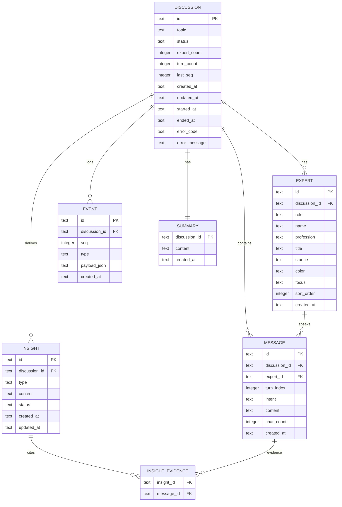

# 数据模型与 ER 图 v0.1

- 日期：2026-10-31
- 状态：草案，待后端评审
- 关联：[PRD](PRD.md)、[API 契约](03-API契约.md)、[SSE 事件契约](04-SSE事件契约.md)

## 1. 设计原则

1. **事件是事实源**：`events` 表记录会话内不可变事实；`messages`、`insights`、`summary` 是可重建投影。
2. **会话隔离**：所有业务表都带 `discussion_id`，查询必须带会话条件。
3. **顺序明确**：每个会话独立 `seq`，从 1 递增；事件表 `(discussion_id, seq)` 唯一。
4. **回放不调 LLM**：回放只读事件与投影。
5. **时间统一 UTC**：存 ISO 8601 字符串或 Unix ms；API 输出 ISO 8601。
6. **SQLite 务实**：`TEXT` 存 UUID/ISO 时间/JSON；`INTEGER` 存序号/轮次；开启 WAL 与 `busy_timeout`。

## 2. ER 图



## 3. 表说明

### 3.1 discussions

| 字段 | 类型 | 说明 |
| --- | --- | --- |
| id | TEXT PK | UUID |
| topic | TEXT NOT NULL | 2–200 字 |
| status | TEXT NOT NULL | draft/generating/ready/live/summarizing/ended/failed |
| expert_count | INTEGER NOT NULL | 3–6，默认 4 |
| turn_count | INTEGER NOT NULL DEFAULT 0 | 已完成发言轮次 |
| last_seq | INTEGER NOT NULL DEFAULT 0 | 该会话最后持久化事件序号 |
| created_at | TEXT NOT NULL | ISO 8601 |
| updated_at | TEXT NOT NULL | ISO 8601 |
| started_at | TEXT | 确认开始时间 |
| ended_at | TEXT | 结束时间 |
| error_code | TEXT | 失败码 |
| error_message | TEXT | 可读错误，不含堆栈/Key |

索引：`status`、`updated_at`。

### 3.2 experts

| 字段 | 类型 | 说明 |
| --- | --- | --- |
| id | TEXT PK | UUID |
| discussion_id | TEXT FK | 级联删除 |
| role | TEXT | host/expert |
| name | TEXT | 中文姓名 |
| profession | TEXT | 职业 |
| title | TEXT | Title/头衔 |
| stance | TEXT | 一句话立场 |
| color | TEXT | 十六进制色，唯一 |
| focus | TEXT | 当前关注点（公开） |
| sort_order | INTEGER | 展示顺序 |

索引：`(discussion_id, sort_order)`；`(discussion_id, role)`。

### 3.3 messages

| 字段 | 类型 | 说明 |
| --- | --- | --- |
| id | TEXT PK | UUID |
| discussion_id | TEXT FK |  |
| expert_id | TEXT FK |  |
| turn_index | INTEGER | 从 1 开始 |
| intent | TEXT | opening/probe/rebut/support/extend/summary |
| content | TEXT | 1–2 句 |
| char_count | INTEGER | 用于长度校验 |
| created_at | TEXT | ISO 8601 |

索引：`(discussion_id, turn_index)`、`(discussion_id, created_at)`。

### 3.4 insights

| 字段 | 类型 | 说明 |
| --- | --- | --- |
| id | TEXT PK | UUID |
| discussion_id | TEXT FK |  |
| type | TEXT | consensus/divergence/open_question |
| content | TEXT | 一句话结论 |
| status | TEXT | active/resolved |
| created_at | TEXT |  |
| updated_at | TEXT |  |

索引：`(discussion_id, type, updated_at)`。

### 3.5 insight_evidence

| 字段 | 类型 | 说明 |
| --- | --- | --- |
| insight_id | TEXT FK |  |
| message_id | TEXT FK |  |

主键：`(insight_id, message_id)`。用于“共识/分歧有依据”。

### 3.6 events

| 字段 | 类型 | 说明 |
| --- | --- | --- |
| id | TEXT PK | UUID |
| discussion_id | TEXT FK |  |
| seq | INTEGER | 会话内从 1 递增 |
| type | TEXT | 语义事件类型 |
| payload_json | TEXT | JSON，Zod 校验后写入 |
| created_at | TEXT | ISO 8601 |

唯一索引：`(discussion_id, seq)`；索引：`(discussion_id, type)`。

### 3.7 summaries

| 字段 | 类型 | 说明 |
| --- | --- | --- |
| discussion_id | TEXT PK | 一对一 |
| content | TEXT | 自然语言总结 |
| created_at | TEXT |  |

## 4. 状态与事务

### 4.1 创建讨论

```text
BEGIN
  INSERT discussions(status=generating)
  -- 调 LLM 生成阵容（不放在事务里）
  INSERT experts(...)
  INSERT events(roster.ready)
  UPDATE discussions(status=ready, last_seq=...)
COMMIT
```

LLM 调用不应包在数据库事务中，避免长时间锁库。生成成功后用一个短事务写入 experts + event + status。

### 4.2 完成一次发言

```text
BEGIN
  INSERT messages(...)
  INSERT events(message.completed, seq=next)
  UPDATE discussions(turn_count=turn_count+1, last_seq=next, updated_at=now)
COMMIT
```

- `message.delta` 不落库。
- 共识/分歧更新单独事件与短事务。
- 同一会话用一个串行队列，避免并发写同一个 `seq`。

### 4.3 结束讨论

```text
BEGIN
  UPDATE discussions(status=summarizing)
COMMIT
-- 调 LLM 生成总结
BEGIN
  INSERT summaries(...)
  INSERT events(summary.completed, seq=next)
  UPDATE discussions(status=ended, ended_at=now, last_seq=next)
COMMIT
```

结束接口幂等：已 ended 直接返回当前详情。

## 5. 事件类型与投影

| 事件 | 持久化 | 投影 |
| --- | --- | --- |
| discussion.created | 是 | discussions |
| roster.ready | 是 | experts |
| discussion.started | 是 | discussions.status=live |
| turn.started | 是 | 当前 speaker/状态 |
| message.completed | 是 | messages |
| insight.updated | 是 | insights |
| summary.completed | 是 | summaries |
| discussion.ended | 是 | discussions.status=ended |
| message.delta | 否 | 仅 SSE 实时 |
| error | 可选 | discussions.error_* |

> 详细 payload 见 [SSE 事件契约](04-SSE事件契约.md)。

## 6. 隔离与并发

- 每个 `SessionRunner` 绑定一个 `discussion_id`，只操作该会话。
- 仓储方法签名必须含 `discussionId`；禁止 `findAllMessages()` 这类无会话条件的方法。
- SQLite：`PRAGMA journal_mode=WAL; PRAGMA busy_timeout=5000; PRAGMA foreign_keys=ON;`
- 单进程内每会话串行；不同会话并行。
- 事件 `seq` 用会话级计数器 + 唯一索引兜底；冲突时重试一次。
- 进程重启：把 `live/summarizing` 标记为 `failed` 或 `interrupted`，允许从事件回放，不自动重跑 LLM。

## 7. 种子数据要求

至少 5 条：

1. 已结束、含完整 transcript/共识/总结，可直接回放。
2. 进行中、含 3–5 条发言和实时共识。
3. 待确认阵容（ready）。
4. 刚创建、生成中/失败示例（用于空态/错误态）。
5. 另一个已结束议题，用于首页对比与多会话演示。

每条样例需有真实感的中文议题、主持人 + 4 位专家、立场差异、专属颜色。

## 8. 待后端确认

- `events.payload_json` 是否只存语义事件；`message.delta` 不落库。
- `last_seq` 是否由 discussions 维护，还是查询 MAX(seq)。
- `insights` 是全量替换还是增量 upsert；建议按 `id` upsert，保留证据。
- 失败状态用 `failed` 还是 `interrupted`；建议对用户统一显示“已中断”，内部记录 `error_code`。
- 是否需要 `discussion_settings` 表存模型/轮次配置；MVP 可不做，放环境变量。
